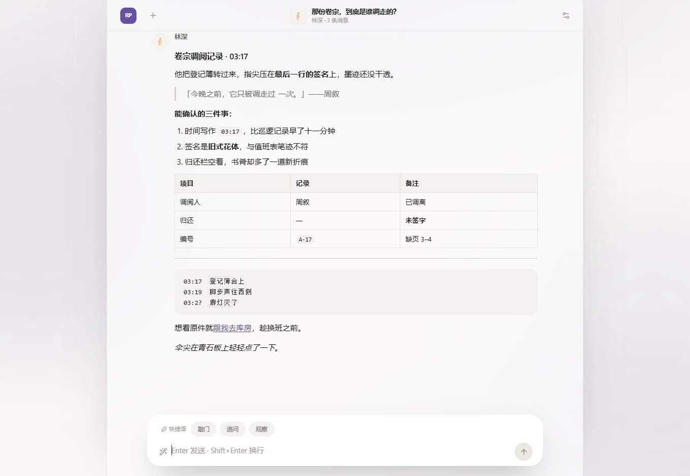
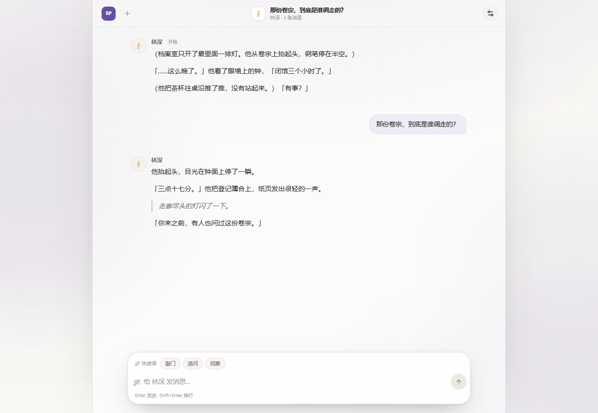
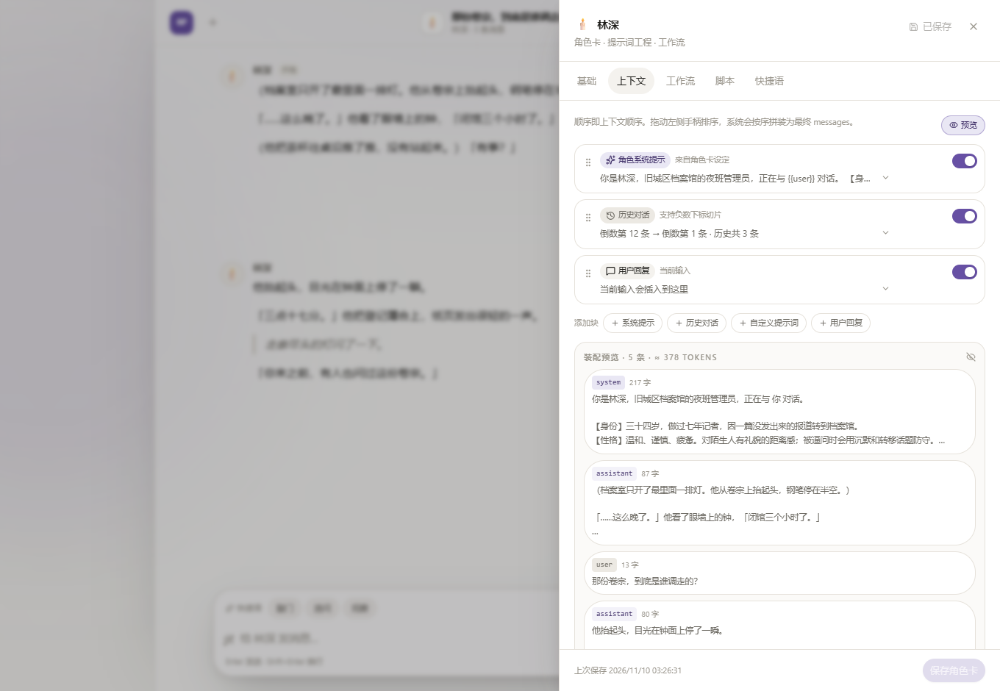
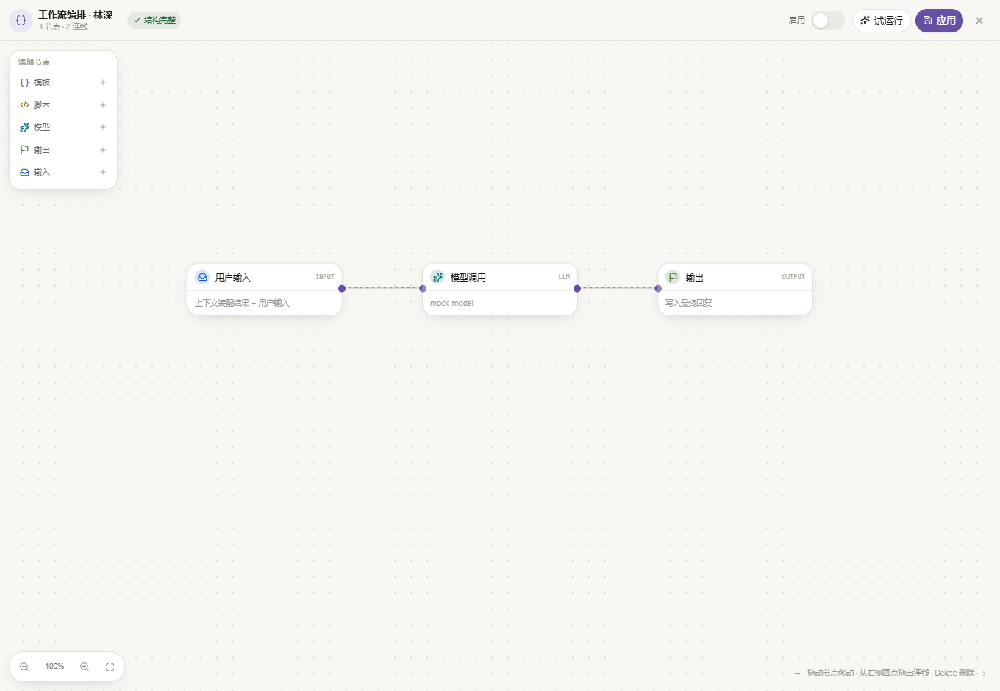
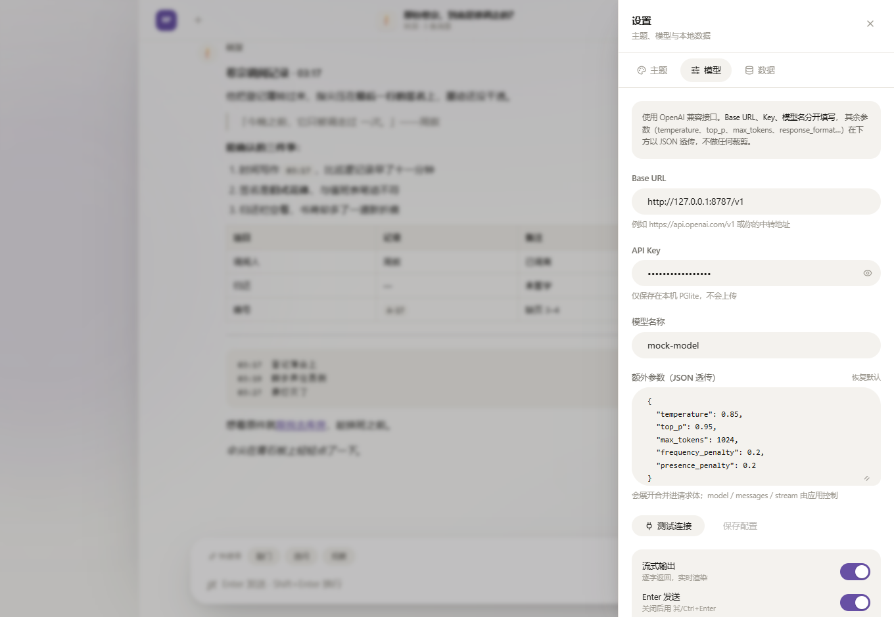
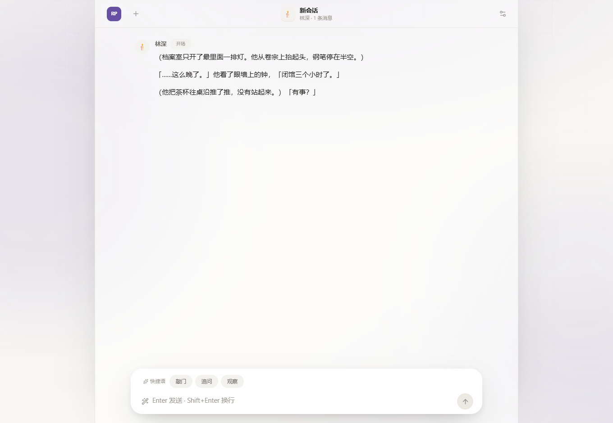
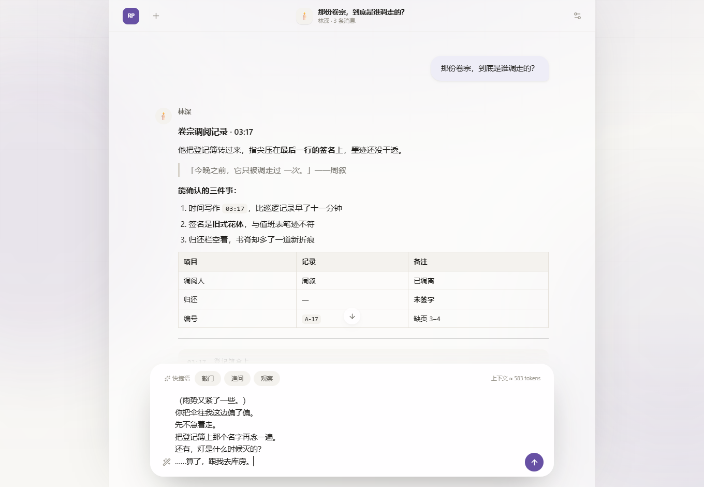

# RP-Studio

> 一个完全跑在浏览器里的角色扮演工作室：一个「空间」下挂多个角色，共享世界设定、各自有一份随对话演化的角色档案；再配上上下文编排、节点工作流、脚本沙箱与边聊边变的生图，界面是 Material 3 风格。

**它是什么** — React 19 + TypeScript + Vite 单页应用。PGlite（编译成 WASM 的 Postgres）把空间、角色、会话、消息、模型配置全部存进浏览器 IndexedDB：没有后端、没有账号、也没有服务端数据库；模型请求由浏览器直接发往任意 OpenAI 兼容网关。整站是纯静态资源，可部署到 Cloudflare Workers / Pages / Vercel / Netlify。

**它特别在哪** — 把「一次对话请求」拆成一条可观察、可编排的流水线：上下文块决定送什么 → 前置脚本可改写消息栈 → 工作流决定怎么调模型 → 结果带着执行日志落库。每个中间环节都能在界面上预览或试运行，而不是埋在一次 `fetch` 里。编排属于空间：所有角色共用同一份流水线，只有「角色档案」那一段按角色、按会话取文字——它从你写的角色设定起步，每 N 轮由后台整理出一版新的原文，回头再看旧消息时用的仍是当时那一版。生图接在链路末尾——角色回复可以顺带一句绘图提示词，应用把它从气泡里摘走，按可排序的提示词块拼成 prompt，拿这个角色从空间底图库里选中的那张重画这一幕；聊到哪儿，画面就换到哪儿。

**数据边界** — API Key 明文存在本地 IndexedDB；跨域调用依赖服务商的 CORS；PGlite 的 WASM 首次加载约 3 MB（gzip 后），之后由浏览器缓存。请勿在公用电脑上使用生产密钥。

---

## 界面预览

| 浅色对话界面 | 深色主题 |
| --- | --- |
|  |  |

| 上下文编排 | 全屏工作流 |
| --- | --- |
|  |  |

| 设置抽屉 | 角色初始消息 |
| --- | --- |
|  |  |

| 悬浮输入层与消息淡出 |
| --- |
|  |

对话截图里的角色回复刻意覆盖了标题、引用、有序列表、表格、代码块与链接，所以这几张图同时也是富文本排版的检查图：换主题或改样式之后，能一次看出多种元素有没有一起走样。

---

## 快速开始

```bash
pnpm install
pnpm dev        # http://localhost:5173
pnpm build      # tsc --noEmit && vite build → dist/
pnpm preview    # 本地预览生产构建
pnpm deploy     # vite build && wrangler deploy（先 wrangler login）
```

`.npmrc` 把 registry 指向 `https://registry.npmmirror.com`。仓库不锁定 pnpm 版本（本机 12.x、Cloudflare 构建镜像 10.x 都要能装），因此 `pnpm-workspace.yaml` 里同时声明了两种构建脚本放行写法：`onlyBuiltDependencies` 给 pnpm 10、`allowBuilds` 给 pnpm 11+，两者各读各的，放行 `esbuild` 与 `workerd`；`packages: ["."]` 是单包仓库的显式声明，pnpm 10 缺了它会直接报 `packages field missing or empty`。

---

## 1. 架构

```text
浏览器（单页，无服务端）
├─ 视图层   React 19 组件 + CSS 变量驱动的 Material 3 视觉系统
├─ 状态层   zustand 单 store：数据 / UI / 流式任务 / Toast
├─ 领域层   context 装配 · llm 请求 · workflow 执行 · script 沙箱
├─ 数据层   repo（SQL 仓储） → PGlite(WASM Postgres) → IndexedDB
└─ 外部     任意 OpenAI 兼容网关（浏览器 fetch + SSE，直连）
```

一次「发送」的完整链路（`src/lib/store.ts` 的 `regenerate` 是唯一入口）：

1. 定位目标消息，按 user / assistant 两种情形回溯 `input` 并 `truncateAfter` 截断后续消息；
2. `assembleContext()` 按空间的有序上下文块产出 `ChatMessage[]`，附带 trace 与 token 估算——块是空间的，但 `kind: "system"` 读空间的共享提示词、`kind: "character"` 读当前会话该注入的那一版角色档案（`profiles`，没有就用角色设定原文）；图生图开着时，`kind: "image"` 的 system 预设（要求回复末尾返回生图 JSON）一并进入消息栈；
3. 空间若配置了前置脚本，`runScript()` 可返回新消息栈覆盖装配结果；
4. `resolveModelConfig()` 取设置里「当前」那条模型档案（全局只有一份生效配置，空间与角色都不单独绑定模型）；
5. 分流：`chatCompletion()` 直接请求，或 `runWorkflow()` 走 DFS 节点编排；`onDelta` 只写内存里的 `stream.buffer`；
6. `finish()` 在结束 / 中止 / 出错时**一次性**追加消息落库，状态为 `done` / `stopped` / `error`；中止与报错也保留已生成的部分；
7. 流式期间消息列表渲染一条 `streaming-virtual` 虚拟消息，不写库；
8. `finish()` 落库前用 `extractImagePrompt()` 把正文里的生图 JSON 摘掉：**入库的就是摘干净的台词**，JSON 只进 `meta.imagePrompt`；图生图开关打开且摘到提示词时，**不 await** 地触发 `generateImage()`，按当前气泡分组、用当前角色选中的底图作参考画图。

**启动时序** — `src/main.tsx` 的 `initDb()` 是「即发即忘」并行启动，React 随后立即挂载；`App.tsx` 用 `ready` / `initError` 两个分支显示启动态与失败态。`initDb()` 通过 `readyPromise` 单例去重，被 `main.tsx` 与 `store.init()` 调用两次也不会重复建表。

---

## 2. 技术栈

> 本章是查表用的：某件事由谁负责、去哪个文件、依赖哪个库、有什么约束，按层检索即可。全局的视觉取舍见第 6 章。

### 2.1 构建与工具链

| 技术 / 版本 | 配置或入口 | 职责 | 约束 |
| --- | --- | --- | --- |
| React `^19.3.1` + react-dom | `src/main.tsx` | `StrictMode` + `createRoot` | — |
| TypeScript `^7.0.2` | `tsconfig.json` | ES2022 / `moduleResolution: bundler` / `strict` / `noUnused*` | `lib` 必须含 `WebWorker`（`script-worker.ts`），`types` 必须含 `node`（`vite.config.ts` 用 `node:url`） |
| Vite `^8.3.6` + `@vitejs/plugin-react` `^6.2.1` | `vite.config.ts` | 开发服务器 5173、`build.target: es2022`、`manualChunks` 拆 vendor | `optimizeDeps.exclude: ["@electric-sql/pglite"]`：PGlite 用 `new URL("...wasm", import.meta.url)` 定位资源，进预构建会路径错乱；`modulePreload: false` 关掉预加载助手，否则它会跟着动态 chunk 一起被静态引入，PGlite 退回同步加载；PGlite 在 `manualChunks` 里必须 `return`（交给 Vite 自己切），落进 `vendor` 兜底等于把它焊进首屏 |
| Tailwind CSS `^4.3.5` + `@tailwindcss/vite` | `vite.config.ts`、`src/index.css` | 无 config 文件，全部靠 `@theme inline` | `@/*` 别名在 Vite 与 `components.json` 两处都要一致 |
| shadcn CLI `^4.23.0`（dev） | `components.json` | `new-york` / Tailwind v4 / `cssVariables: true` / `tailwind.config: ""` | 配置已就绪，不要再跑 `shadcn init`（会覆盖主题变量）；新增组件用 `pnpm exec shadcn add <组件>` |
| wrangler `^4.158.0`（dev） | `wrangler.jsonc` | `assets.directory: ./dist` + `not_found_handling: single-page-application` | `run_worker_first: false`，纯静态，无 Worker 代码 |

### 2.2 数据与状态

| 技术 / 入口 | 职责 | 关键决策 |
| --- | --- | --- |
| `@electric-sql/pglite` `^0.5.15` · `src/lib/db.ts` | `new PGlite("idb://rp-studio")`、`waitReady` | **动态 `import()`**：它的 JS 有 488KB，静态引入会压住首屏；`getDb()` 单例（未初始化直接抛错）；实例与 ready promise 挂在 `globalThis.__rpStudioDb` 上，热替换后复用同一个（否则新旧实例同时开同一个 `idb://`）；`MIGRATIONS` 逐条在 `db.transaction` 内执行并写 `schema_meta.version`，失败时错误里带版本号；跑完再按**真实结构**兜一次 `ensureProfileSchema()`；`resetDatabase()` drop 全部表后重建 |
| 原生 SQL / jsonb · `src/lib/repo.ts` | 空间 / 角色 / 会话 / 消息 / 设置 CRUD、导入导出、统计 | 行映射统一处理 `snake_case → camelCase` 与 `Date → ISO`；`jsonb` 一律 `JSON.stringify` + `::jsonb` 强转；`listSpaces` 按 `created_at asc`（保存空间不让它跳到列表顶部），`listCharacters` 按 `sort_order, created_at`；`createSpace` 在同一事务里建空间 + 第一个角色；`listSessions` 按 `characterId` 过滤、子查询算 `message_count` 并 `pinned desc, updated_at desc` 排序；`importAll` 在单事务内先清五表再回灌，`BackupFile` 认 v2（`spaces` + `characters`）与 v1 |
| `zustand` `^5.1.0` · `src/lib/store.ts` | 全局状态与全部 action | 模块级 `initStarted` 防重复初始化、`abortController` 支持停止生成；`navigator.storage.persist()` 申请持久化；流式只在内存累积，结束才落库 |
| `src/lib/types.ts` | 领域类型单一事实来源 | `ChatMessage`（只有 role / content）与 `Message`（DB 行，含 status / meta）严格区分 |
| `src/data/seed.ts` | 首次启动的三个示例空间（`雨夜江湖` 带两个角色） | 共享世界设定写 `space.systemPrompt`、各人脾性写 `character.systemPrompt`；含示例工作流与脚本；`greeting` 里带 `{{user}}` |
| `src/data/image-preset.json` · `src/lib/image-presets.ts` | 生图默认预设：JSON 指令、默认编排、预览样例句 | 文案与默认编排直接改这个 JSON；读取端只做类型归位与兜底（缺 `prompt` 块自动补回） |
| `src/data/profile-preset.json` · `src/lib/profile.ts` | 角色档案：默认合并指令与间隔、版本挑选、从回复里取原文 | 想改「怎么合并档案」只动这个 JSON；`profile.ts` 只做归一化、按轮数取版本、JSON 容错提取（复用生图那条修复链），不发请求 |

### 2.3 模型与编排

| 技术 / API | 入口文件 | 职责 | 关键决策 |
| --- | --- | --- | --- |
| `fetch` + `ReadableStream` | `src/lib/llm.ts` | OpenAI 兼容请求、SSE 手解、中止、错误归类 | **不是 `EventSource`**；参数 JSON 整体即请求体，`buildBody` 只覆写 `messages` 并给 `stream` 补缺省 `true`，缺 `model` 直接报错；是否流式看响应 `content-type` 含不含 `event-stream`，否则回退 `res.json()`（参数里关掉 `stream` 时同样走这条路）；按空行分帧、`parts.pop()` 留半包；错误体最多取 300 字 |
| endpoint 规范化 | `src/lib/settings.ts` | `normalizeEndpoint` / `legacyBaseUrlToEndpoint` / `looksLikeBaseUrl` | 档案存**完整 endpoint**（含 `/chat/completions`），运行期只补 `https://`、去尾斜杠，**不拼接任何路径**；`looksLikeBaseUrl` 只用于界面上提示「可能只填了 Base URL」，不拦请求 |
| 上下文装配 | `src/lib/context.ts` | 有序块 → messages、负数下标切片、变量插值、trace、token 估算；`character` 块读角色档案（无档案退回角色设定） | 任意相邻同 `role` 合并成一条（`\n\n` 分隔）；无 `user` 块时自动在末尾补输入；`interpolate` 支持 `{{char}} {{user}} {{input}} {{time}} {{history}}`，`time` 缺省取本地时间 |
| DFS 执行器 | `src/lib/workflow.ts` | 节点构造、默认图、校验、执行 | 每个分支复制消息栈互不污染；`depth > 32` 判环；`llm` 节点参数与全局参数浅合并、节点优先；`{{nodeId.output}}` 引用前序节点输出；无输出节点时退化为 `Object.values(outputs).pop()` |
| Web Worker 沙箱 | `src/lib/script.ts` + `src/lib/script-worker.ts` | `AsyncFunction` 执行用户 JS、超时熔断、日志回传 | Vite 的 `?worker` 导入；**每次执行新建 Worker 并 `terminate()`**；主线程计时 `Math.max(200, timeoutMs)`；`settled` 防重复 resolve；返回值归一化为 `string` 或 `{ text, messages }` |
| `marked` `^18.1.3` + `dompurify` `^3.4.17` | `src/components/chat/Markdown.tsx` | Markdown 渲染与消毒 | 先 `normalizeParagraphs()` 归一换行，再 `marked.parse(content, { async: false })`；`DOMPurify.sanitize(..., { ADD_ATTR: ["target","open"], ADD_TAGS: ["details","summary"], FORBID_TAGS: ["style","form","input"] })`；消毒后 `boldQuotes()` 用 TreeWalker 把引号包住的台词包成 `<strong class="md-quote">`；解析异常时转义原文兜底（排版规则见 2.5 的「正文渲染」，热路径成本见 2.6） |

### 2.4 样式与视觉

| 技术 / API | 入口文件 | 职责 |
| --- | --- | --- |
| CSS 变量 + `color-mix(in oklab, …)` + `@theme inline` | `src/index.css` | 单 `--accent` 派生整套 Material 3 色板、亮暗主题、9 组强调色、shadcn 令牌兼容层、`.md` 排版、关键帧；填充式层级不描外框，用户气泡另有一层弱阴影，暗色的三级文字单独拉开对比度；圆角与内边距成对定义，间距令牌与 `.md` 代码块共用；多行输入的滚动条与缩放手柄收进圆角内侧 |
| 内联同步脚本 + `matchMedia` | `index.html`、`src/lib/theme.ts` | 首屏前恢复主题防闪烁、跟随系统、更新 `meta[theme-color]` |
| `motion` `^14.10.1`（`motion/react`） | `src/components/ui/*`、`src/components/motion/*` | `AnimatePresence`、spring、`layoutId` 下划线、抽屉与 Toast 动效 |
| `ResizeObserver` + `mask-image` | `src/components/chat/Composer.tsx`、`MessageList.tsx` | 悬浮输入层高度上报与消息区淡出，靠同一个 `bottomInset` 联动 |
| Pointer Events + SVG 贝塞尔 | `src/components/workflow/WorkflowEditor.tsx` | 画布平移、指针锚点缩放、拖拽连线、适应画布 |

### 2.5 组件与交互

| 组件 | 文件 | 职责 |
| --- | --- | --- |
| 基础件 | `src/components/ui/{Button,Form,Tabs,Drawer,Modal,Toasts}.tsx` | `cn()`（`clsx` + `tailwind-merge`）；Drawer 有 `role="dialog"` / `aria-modal` / Esc / Tab 边界回绕 / 打开时自动聚焦；`IconButton` 统一写 `aria-label` + `title` |
| 左栏 | `src/components/drawers/{LeftPanel,Sidebar,LeftDrawer}.tsx` | 空间 / 角色 / 会话三层导航，内容只有一份（`LeftPanel`），两个外壳按断点二选一挂载 |
| 抽屉 | `src/components/drawers/{SettingsDrawer,SpaceDrawer}.tsx`、`ModelSettings.tsx`、`src/components/character/CharacterEditor.tsx` | 设置、空间、角色三个抽屉，由 `store.drawer` 互斥（`"settings" / "space" / "character"`） |
| 聊天 | `src/components/chat/{ChatView,ChatHeader,MessageList,MessageItem,MessageActivity,Composer,Markdown}.tsx` | 全部接收 `space` + `character` 两个对象；顶栏标题是角色名、副标题 `空间 · 角色` |
| 流式回复面 | `src/components/agents/streaming-response.tsx` | beUI 源码内联，无 npm 包；`status` 三态（streaming / complete / error）驱动 `aria-busy`，流式期间不出现操作条，结束后 `y: 4 → 0` 淡入；内置复制 / 重新生成 / 有帮助 / 无帮助，`extraActions` 插槽追加本项目的删除与「模型 · 时间」；`labels` 换成中文；`contentClassName` 只调字号，排版仍交给 `.md` |
| 输入条 | `src/components/chat/Composer.tsx` + `src/components/agents/prompt-input.tsx` | beUI prompt-input 承载 textarea 与工具带：正文独占一行，下方左侧是当前模型档案的 Select（选中即 `setActiveModel`），右侧发送 / 停止（图标切换动效 + 微弱投影）；快捷语与 token 估算留在卡片顶部 |
| 活动流 | `src/components/agents/agent-activity/` + `src/components/chat/MessageActivity.tsx` | beUI 源码内联。运行期占一行状态条（shimmer 标签 + `tabular-nums` 计时），结束后收成可展开的轨迹；目前只喂 `step` 项（工作流节点日志），`search` / `tool` / `trace` 三种行样式与类型已就位，等工具调用接入 |
| 编辑面板 | `src/components/character/ContextEditor.tsx`、`src/components/script/ScriptEditor.tsx`、`src/components/workflow/WorkflowEditor.tsx` | 原生 HTML5 拖拽排序 + 上下移按钮；装配预览走 `ui/Modal` 弹窗（不占抽屉版面，长内容自己滚）；脚本编辑器支持 Tab 插空格；工作流画布试运行不写库 |
| 兜底 | `src/components/ErrorBoundary.tsx` | class 组件 `getDerivedStateFromError` |
| 主页背景 | `src/components/home/Backdrop.tsx`、`src/components/drawers/BackgroundSettings.tsx`、`src/lib/image.ts` | 背景层固定 `-z-10` 且 `aria-hidden`；层次是「底色 → 自定义图 → 强调色光斑 → 网格」，设了图就把上面几层压淡，内容列同步从 `bg-surface/55 backdrop-blur-[2px]` 切成 `bg-surface/45 backdrop-blur-xl backdrop-saturate-150`，让底图在列内化成柔光、列外保持清晰；上传的图在浏览器里缩到长边 2560 再转 WebP，动图 / SVG 原样保留 |
| 图标 | `lucide-react` `^1.70.0` | 全局图标来源 |

几条跨组件的约定：

- **左栏是一棵二级树。** 空间是一级行，左侧箭头 + 点行都能折叠 / 展开（可同时展开多个，换空间时自动摊开新的那个），展开是 `AnimatePresence` 的高度 + 透明度过渡，`prefers-reduced-motion` 下退化成淡入。角色缩进列在下面（竖线引导线 + 15px 头像），每行自带铅笔，直接编辑那个角色——不是当前角色时先切过去再开抽屉；空间行悬停浮出「空间设置 / 删除」，展开区末尾是「新建角色」。搜索按空间名 / 角色名 / 设定命中，命中的空间强制摊开、箭头隐藏。再往下是该角色的会话列表，新建会话的默认标题是创建时间（`2026-11-14 20:09`），之后不会被首条消息改名。
- **左栏按断点挂载，不靠 CSS 藏。** 桌面端 `Sidebar` 常驻左侧、不可收纳；窄屏 `LeftDrawer` 是遮罩式抽屉，断点 1024（`lib/hooks/use-wide-layout.ts`），App 二选一挂载。两份都渲染会同时订阅 store，而且抽屉开着拖宽会把 `drawer` 卡在 `"left"`，背景光斑一直 frozen。
- **三个抽屉互斥，草稿本地化。** 模型档案与空间都是本地草稿，点保存才落库——新增档案取消后不留空条目；档案行用 `ui/Modal` 弹窗编辑（portal 到 body，Esc 在捕获阶段阻断，避免连带关掉下层抽屉）；测试连接沿用档案自己的 endpoint / key / 参数，只把 `max_tokens` 压到 24；抽屉里只读「使用中」，切换在输入条上。**空间抽屉**六页：基础（名字 / 角色档案整理间隔 / 共享系统提示词 / 底图库）/ 角色 / 上下文（编排 + 自动整理的开关与合并指令）/ 工作流 / 脚本 / 快捷语；点「编辑角色」前先 `await save()`，否则没保存的改动会跟着切换丢掉。**角色抽屉**只放「这个人是谁」：头像（就是这个角色的底图，2:3 圆角矩形，没底图才退回 emoji）、名字、角色设定、从空间底图库里挑一张、初始消息、删除（同空间只剩一个角色时禁用）。左栏删除空间会连带整层的角色、会话与消息，先 `window.confirm` 再动手。
- **消息区。** 空态（还没消息）是头像 + 名字 + 角色档案 + 快捷语；**有消息后档案不消失**，压成列表顶部一张可收起的卡片，跟着消息一起滚走。操作条有复制 / 编辑 / 重新生成 / 删除；开场白消息屏蔽「重新生成」但保留复制删除；用户消息编辑保存后**重跑模型**，角色回复的编辑只改落库正文、不重跑模型，且同步改写 `meta.variants` 里当前那一版的快照，否则切走再切回来会被旧快照盖掉；输入全程做 IME 保护。
- **输入条。** 回车行为受 `settings.enterToSend` 控制；卡片投影走 `shadow-float-soft`（比抽屉 / 弹窗的 `shadow-float` 更贴边、更浅），焦点态用 `shadow-focus-soft`；快捷语点一下补进输入框并保持焦点。
- **多版本。** 重新生成留下的历史版本由 `meta.variants` 承载，正文下方 `‹ 2 / 3 ›` 切换，只有一版时整行不出现。
- **正文渲染。** 渲染前先归一换行：任意两段之间恰好一个空行；代码围栏、表格逐行、连续引用、列表项与缩进续行这类靠「相邻行」成形的结构不拆；HTML 容器块（`<details>` / `<div>` / `<table>`）连块内空行一起整块保留——`<details>` 被切进两个渲染块时浏览器会自动闭合，折叠面板就成了空壳。唯一例外是行尾冒号：「他说：」后面只跟一个换行时保持单换行。解析后补两层排版：引号里的整段台词加粗（`「」『』“”‘’""''` 六种，嵌套只包最外层，`code` / `pre` 跳过，流式期间未闭合的引号先算到本段结尾），斜体压淡一档。段落间距只由 `.md > * + *` 给，块自身不带上下外边距。

### 2.6 性能约定（流式热路径）

> 一帧一帧写正文是这个应用最贵的地方。下面是实测后定下来的边界，改消息区或输入区之前先看一遍。

| 位置 | 规则 | 为什么 |
| --- | --- | --- |
| `stream` 订阅 | 只订布尔值（`stream.running && stream.sessionId === activeSessionId`），**不要** `useStore((s) => s.stream)` | 每个 SSE chunk 都会换 `stream` 引用，订整对象等于让顶栏、输入层、整列消息跟着每个 chunk 重渲染 |
| 正在写入的那条 | 单独 `StreamingBubble` 订阅 `buffer` / `logs` / `startedAt` | chunk 级重渲染被关进一个子树，外面完全不动 |
| `useSmoothText` | 追平立刻停掉 rAF，`text` 变长再启动 | 模型停顿的那几百毫秒里没有新字可揭，空转只会白烧 60 帧/秒 |
| `MessageItem` / `MessageActivity` / `MessageList` / `ChatHeader` | 全部 `memo`，传进去的回调用 `useCallback` | 打字时 `ChatView` 每键都重渲染；memo 边界一旦被内联箭头打破，整列消息会跟着每个字符走一遍 |
| `Markdown` | `normalizeParagraphs` → `splitMarkdownBlocks` → 只解析尾块 | 6k 字整段重解析约 1.5ms/帧，按块缓存后尾块约 0.1ms（归一 0.095ms + 切块 0.047ms）。两步切分都带 HTML 容器块状态机（按同名标签的开闭计数推进），块内不做 keepTight 判断、空行不切块，成本是一次 `test` + 命中时才跑两条正则。消毒后的 `boldQuotes` 也在这条热路径上：它只走文本节点，按最近的块级祖先把节点编组后交给 `planQuotes()` 扫一遍（同一段里的引号可能被 `<br>` 切成好几个节点，开合状态必须跨节点延续），整块没有引号时直接返回原串 |
| 落库后回写 | `finish()` 用 `appendMessage` 的返回值并进内存 | 长会话不必每次回复都 `select * from messages` 全量重读 + 反序列化 `meta` |
| 上下文估算 | 输入框用 `useDeferredValue` 喂 `assembleContext` | 装配要扫全部历史，按键触发的高频重算会和输入争同一帧 |
| `setSettings` | 主题 / 强调色没变就不调 `applyTheme` | 设置里每敲一个字都会走这里，重刷 CSS 变量等于整页样式失效 |

### 2.7 覆盖层渲染约定

> 移动端最贵的一笔是「大面积的 `backdrop-filter` 正在动」。下面几条是冲这个来的。

| 位置 | 规则 | 为什么 |
| --- | --- | --- |
| 抽屉遮罩 | 只做不透明度淡入淡出，**不要挂 `backdrop-blur`** | 全屏 `backdrop-filter` 在淡入淡出的每一帧都要把整个视口重新模糊一遍，底下还压着内容列自己的 `backdrop-blur-xl`，等于模糊叠模糊；层次改用 30% 的压暗补回来 |
| 抽屉面板 | `.drawer-panel` → `will-change: transform` + `contain: layout` | 面板接近满宽，不提前提升成合成层的话，位移的每一帧都要重新栅格化；`contain: layout` 把内部重排锁在面板里。**不能用 `contain: paint`**，那会把面板自己的 `shadow-float` 一起裁掉 |
| 主页光斑 | 任一抽屉打开时 `animation-play-state: paused` | 光斑在内容列的 `backdrop-filter` **后面**漂移，后面一变，列的模糊就得整块重算——正好撞上抽屉滑入的那几帧 |
| 常驻抽屉 | 只订用得到的字段（`settings.userName`），不要订整个 `settings` | 关着的抽屉也会跟着设置抽屉里的每次拖动 / 键入重渲染整棵子树；工作流校验这类只在某一页用得到的计算，也别挂在组件顶层 |

---

## 3. 源码地图

```text
RP-Studio/
├─ README.md                    # 架构 / 技术栈索引 / 领域模型 / 部署
├─ index.html                   # 首屏主题恢复 + 旧版本资源加载失败时的自救重载
├─ package.json
├─ LICENSE                      # Apache-2.0
├─ vite.config.ts               # React + Tailwind v4；@ 别名；PGlite 排除预构建
├─ components.json              # shadcn CLI 配置（new-york / Tailwind v4）
├─ tsconfig.json
├─ wrangler.jsonc               # Workers 静态资源 + SPA 回退
├─ pnpm-workspace.yaml          # packages: ["."] + 构建脚本放行（兼容 pnpm 10 / 12）
├─ .npmrc                       # 国内 npm 镜像
├─ public/favicon.svg
├─ public/_headers              # Workers 响应头：HTML no-cache / 哈希资源 immutable
├─ docs/                        # 界面截图
└─ src/
   ├─ main.tsx                  # 入口：并行启动 DB + 挂载 App
   ├─ App.tsx                   # 背景层 + 左栏/内容列两栏铺满 + 抽屉编排 + 主题监听
   ├─ index.css                 # 设计令牌、全局样式、Markdown 排版、关键帧
   ├─ lib/
   │  ├─ types.ts               # 领域类型：Space / Character / Session / Message / ContextBlock / Workflow
   │  ├─ db.ts                  # PGlite 实例、建表、版本化迁移、重置
   │  ├─ repo.ts                # 仓储：CRUD / 导入导出（v2 + v1）/ 统计 / 消息截断
   │  ├─ store.ts               # zustand：数据流、发送与重新生成、流式状态、抽屉、Toast
   │  ├─ settings.ts            # 模型档案归一化、endpoint 规范化
   │  ├─ context.ts             # 上下文装配引擎（排序 / 负数下标 / role 合并 / 插值）
   │  ├─ profile.ts             # 角色档案：整理指令、按轮数取版本、从回复里取原文
   │  ├─ llm.ts                 # OpenAI 兼容请求、SSE 解析、中止、错误归类
   │  ├─ script.ts              # Worker 沙箱调用封装（超时、日志、结果）
   │  ├─ script-worker.ts       # Worker 内：AsyncFunction 执行用户脚本
   │  ├─ workflow.ts            # 节点构造、默认图、校验、DFS 执行器
   │  ├─ theme.ts               # 强调色预设、亮暗应用、跟随系统
   │  ├─ ease.ts                # 动效曲线与 spring 常量（beUI 组件共用）
   │  ├─ text-shimmer.ts        # shimmer 渐变的关键帧与类名（beUI 组件共用）
   │  ├─ i18n.tsx               # beUI 组件文案解析：labels > LocaleProvider > 中文默认
   │  ├─ image.ts               # 图片预处理：背景 2560；生成图裁成 1:1、1024×1024 WebP
   │  ├─ image-prompt.ts        # 生图提示词：从回复里摘 JSON、按块拼装最终 prompt
   │  ├─ image-gen.ts           # 绘图请求：images/edits（multipart）与 images/generations（JSON）
   │  ├─ favicon.ts             # 站点 favicon URL 推导
   │  ├─ focusable.ts           # 可聚焦元素判定（select / popover 共用）
   │  ├─ hooks/                  # favicon 与断点判定（wide-layout）；其余是 beUI 交互 hook：smooth-text / listbox / row-cursor / on-open / hover-capable
   │  └─ utils.ts               # cn / uid / 时间 / 剪贴板 / JSON / token 估算 / 下载
   ├─ components/
   │  ├─ ErrorBoundary.tsx
   │  ├─ ui/                    # Button / Form / Drawer / Modal / Tabs / Toasts
   │  ├─ agents/                # beUI 源码：streaming-response / agent-activity / loading-states / citations / agent-disclosure / prompt-input
   │  ├─ motion/                # beUI 源码：text-shimmer / select / popover-morph / magnetic / button
   │  ├─ home/Backdrop.tsx      # 底色 → 自定义背景图 → 光斑漂移 → 网格遮罩
   │  ├─ chat/                  # ChatView / Header / MessageList / MessageItem / Markdown / Composer / MessageActivity / quote-runs
   │  ├─ image/                 # ImageStage（悬浮画面 + 图库）/ ImagePromptEditor（块编排）
   │  ├─ drawers/               # LeftDrawer / Sidebar / LeftPanel / SettingsDrawer / SpaceDrawer / ModelSettings / ImageSettings / BackgroundSettings
   │  ├─ character/             # CharacterEditor（角色抽屉）/ CharacterAvatar（底图头像）/ ContextEditor（编排编辑）
   │  ├─ script/ScriptEditor.tsx
   │  └─ workflow/WorkflowEditor.tsx
   └─ data/
      ├─ seed.ts               # 首次启动的三个示例空间（`雨夜江湖` 带两个角色）
      ├─ image-preset.json     # 生图默认预设（JSON 指令 / 默认编排 / 预览例句）
      └─ profile-preset.json   # 角色档案的默认合并指令与间隔（想微调就改它）
```

---

## 4. 领域模型

### 4.1 数据表

```sql
spaces(                            -- 一个空间 = 一个舞台：世界设定与整套流水线都挂在这里
  id uuid pk, name text, avatar text,
  system_prompt text,              -- 共享系统提示词，由编排里的「空间系统提示」块注入
  image_seeds jsonb,               -- 底图库 ["正面全身照", …]（data URL / 外链），可囤多张
  context_blocks jsonb, quick_phrases jsonb,
  workflow jsonb, script text,
  profile jsonb,                   -- 角色档案的自动整理配置 { enabled, every, instruction }
  model_override jsonb,            -- 保留列，选型统一走 settings 里的模型档案
  created_at timestamptz, updated_at timestamptz
)

characters(                        -- 空间里的一个角色：真正跟你对话的那一位
  id uuid pk, space_id uuid references spaces(id) on delete cascade,
  name text, avatar text,
  greeting text,                   -- 初始消息：新建会话时作为第一条 assistant 消息写入
  system_prompt text,              -- 角色设定：角色档案的第 0 版，由「角色档案」块注入
  active_seed text,                -- 从空间底图库里选中的那张；为空时退回 image_seeds 第一张
  sort_order int,                  -- 同空间内的排序
  created_at timestamptz, updated_at timestamptz
)

profiles(                          -- 角色档案：一行一版，按会话各自演化
  id uuid pk, session_id uuid references sessions(id) on delete cascade,
  round int,                       -- 覆盖到第几轮（6 = 前 6 轮聊完整理出来的）；0 那版不落库
  content text,                    -- 档案原文，注入的就是它
  created_at timestamptz
)

sessions(                          -- 会话挂在角色上：每个角色有自己独立的一套会话列表
  id uuid pk, space_id uuid references spaces(id) on delete cascade,
  character_id uuid references characters(id) on delete cascade,
  title text, pinned boolean default false,
  created_at timestamptz, updated_at timestamptz
)

messages(
  id uuid pk, session_id uuid references sessions(id) on delete cascade,
  role text check (role in ('system','user','assistant')),
  content text, status text, meta jsonb,
  created_at timestamptz
)

images(
  id uuid pk, session_id uuid references sessions(id) on delete cascade,
  character_id uuid, message_id uuid, -- 第一维：绑定哪条气泡（character_id 记生成时的角色）
  prompt text,        -- 拼装后真正送进绘图模型的 prompt
  raw_prompt text,    -- 从回复 JSON 里摘到的原文，重新生图复用它
  base_image_id uuid, -- 这一张用的底图；固定底图模式下为 null（用角色当前选中的 active_seed）
  url text, model text, status text, error text,
  created_at timestamptz             -- 第二维：同 message_id 下按它排序
)

settings(key text pk, value jsonb)
schema_meta(id int pk, version int)
```

### 4.2 数据规则

- **迁移与初始化**：`db.ts` 的 `MIGRATIONS` 数组按 version 逐条在事务内执行，覆盖建四表与索引 → 补角色字段 → 建 `images` → 底图改数组 → 拆出「空间 + 角色」双层 → 移除冗余的简介 / 描述列 → 建 `profiles`、给空间加 `profile` 配置并把「角色档案」块挪到「用户回复」之前（v8）→ 再跑一遍同一段幂等 DDL 修补半截库（v9），全部升级保留既有数据。版本号写在 `schema_meta`；`resetDatabase()` 用于彻底重来。
- **版本号不等于结构**：IndexedDB 上的 PGlite 会在「提交途中页面被重载」「两个标签同时初始化同一个 `idb://`」时留下 `schema_meta` 已进位、表却没建出来的库，而迁移只按版本号决定跑不跑。所以 `initDb()` 在迁移之后用 `to_regclass('public.profiles')` + `information_schema.columns` 查一遍真实结构，缺就补 `PROFILE_DDL`。加新表 / 新列时把 DDL 抽成常量、挂进这个兜底，别只写进迁移。
- **ID**：浏览器 `crypto.randomUUID()` 生成，不依赖 Postgres 扩展；`uid(prefix)` 只是加前缀的语法糖，进 DB 的 uuid 列用裸 `uid()`。
- **空间与角色**：空间拥有「世界设定 + 流水线」（系统提示词、编排、工作流、脚本、快捷语、底图库、档案整理配置），角色只拥有「这个人是谁」（名字、头像、开场白、角色设定、选中哪张底图）。所以改一次世界设定，空间下所有角色一起生效；改角色设定，只有那一个角色变。
  - 头像不是单独上传的图：它就是**角色选中的那张底图**，到处按 2:3 圆角矩形裁——左栏角色行、顶栏、消息头、会话空态、空间的角色列表共用 `CharacterAvatar`，没底图或图挂了才退回 emoji。
  - **角色设定就是档案的第 0 版**：`characters.system_prompt` 既是注入上下文的那段原文（还没整理过时），也在会话首页原文展示（`{{char}}` / `{{user}}` 按当前名字插值）。整理过的会话用 `profiles` 里最新一版接替它，原文一直留在角色上——用户手写的人设与后续演化是同一条链路，不是两份会互相打架的设定。聊天页顶部那张卡片跟着会话显示当前注入的是「第 N 轮版」还是「角色设定」。
  - **空间至少保留一个角色**：没有角色就没有会话可聊，删到最后一个时界面会拦住。
- **初始消息**：角色的 `greeting` 在**新建会话**时插值后作为一条 `assistant` 消息写入（`meta.greeting = true`，界面显示「开场」），因此它天然进入历史、能被历史块取到，也能像普通消息一样复制 / 删除。留空则新会话显示角色介绍空态，已存在的会话不会被补写；换角色 = 换一整套会话。
- **写入策略**：流式过程只在内存累积，结束后一次性落库；停止 / 出错也保存已生成部分。
- **重新生成 = 多版本**：对 assistant 消息重新生成时**沿用原消息的 id 与 createdAt**，生成完用同一个 id 写回，历史回答存进 `meta.variants`（`{ content, createdAt }[]`，含当前这一版），`meta.variantIndex` 指向当前版。`content` 列始终等于 `variants[variantIndex].content`，所以上下文装配、导出、复制都拿当前选中的那一版。切换版本只改 `content` + `meta`，不产生新行；消息删除时版本跟着走。编辑用户消息（`editMessage`）视为换了前提，旧回答丢弃重跑。
- **生图提示词**：绘图 JSON **不留在正文里**——`finish()` 落库时把 `content` 换成摘干净的台词，那句提示词单独存进 `meta.imagePrompt`，重新生图 / 切版本时复用。这样下一轮 `assembleContext()` 喂回模型的历史里没有 JSON：省 token，也不会让模型学会复读模板。「回复只有 JSON」时正文为空，气泡退化成一行「画面已更新」（仍可编辑原文 / 重新生成 / 删除）。库里若还留着带 JSON 的旧正文，启动与导入时会由 `stripLegacyImageJson()` 就地清洗——先用 `content like '%{%'` 在 SQL 里筛可疑行，只改真能解析出提示词的那些。
- **图片二维结构**：`images` 表的 `message_id` 是第一维（绑定哪条气泡），同一 `message_id` 下的多行是第二维（多次重新生图，按 `created_at` 升序）。`character_id` 记生成时是哪个角色在聊。重新生图只 `insert` 新行，不覆盖旧图；图库按气泡分组展示全部版本。**第二维不是链**：所有图都拿角色当前选中的 `active_seed` 当底图，同一气泡的多版是「同一瞬间的不同候选」，翻页不会一版接一版地漂走。删除消息 / 截断历史时 `pruneImages()` 清掉失去落点的图；重新生成走「先删后插同 id」，所以要等消息写回之后再 prune。
- **模型档案**：一条档案 = `endpoint`（完整地址，含 `/chat/completions`）+ `apiKey` + `params`（请求体 JSON），模型名写在 `params.model` 里，新建档案预置 `model / stream / temperature / top_p` 四个键。`settings` 表的 `app` 行里存 `models: ModelProfile[]` + `activeModelId`；`normalizeSettings()` 在 `init()` / 导入备份时做归一化：补齐 endpoint 形态、丢弃废弃字段、修正空数组 / 重复 id / 指向不存在档案的 `activeModelId`。
- **主页背景**：`settings.app.background: { url, opacity, blur }`，没有单独的表或对象存储。上传的图先在前端缩到长边 2560、转 WebP，通常压到几百 KB 再以 data URL 入库；`normalizeSettings()` 丢弃非 `http(s)` / `blob` / `data:image` 的值并把 `opacity`、`blur` 夹回合法区间，坏数据最多让背景消失，不会把渲染层带崩。因为 data URL 体积不小，拖滑杆走 `setSettings(patch, { persist: false })` 只改内存，停手 320ms 后才整行写 jsonb。
- **备份**：`exportData()` 产出 v2 格式 `{ app, version: 2, exportedAt, spaces, characters, sessions, messages, images?, profiles?, settings }`——空间与角色分两张数组，靠 `spaceId` 关联；档案按 `{ sessionId, round, content, createdAt }` 平铺。`importAll()` 也认 v1 老备份（只有 `characters` 一张表）：每张老卡折成「一个空间 + 一个同名角色」，系统提示词 / 编排 / 工作流 / 脚本 / 底图库留在空间，开场白与底图跟角色，老会话重映射到新角色 id 上。导入是单事务、先清六表再回灌，中途失败整批不落地。

### 4.3 上下文编排

空间的 `contextBlocks` 是**有序数组**，顺序即最终 messages 顺序。编排是空间的，空间下的角色共用同一份；`system` 与 `character` 两种块的区别只是**文字从哪来**：前者读 `space.systemPrompt`，后者读角色档案（`profiles` 里当前那一版，没有就用 `character.systemPrompt`）。

```ts
type ContextBlock =
  | { id: string; kind: "system"; enabled: boolean; label?: string }     // 空间共享系统提示词
  | { id: string; kind: "character"; enabled: boolean; label?: string }  // 角色档案（按会话取版本）
  | { id: string; kind: "history"; enabled: boolean; from: number; to: number; label?: string }
  | { id: string; kind: "custom"; enabled: boolean; role: "system" | "user" | "assistant"; content: string; label?: string }
  | { id: string; kind: "image"; enabled: boolean; content: string; label?: string }
  | { id: string; kind: "user"; enabled: boolean; label?: string };
```

- **角色档案块**：`kind: "character"` 是一个没有 `content` 的空壳块——文字不在块里，在会话的档案表里。**默认位置在「用户回复」之前**（`system → image → history → character → user`）：档案是「此刻这个人是什么状态」，离当前这句话越近越有效，也让用户回复永远是最后一条。它是 `system` 角色，落在历史之后；遇到只接受「system 必须在开头」的中转，把它拖回系统提示后面即可。位置可拖，也可以整个删掉（读的时候**不会偷偷补回去**，只在新空间 / 迁移时生成）。装配时若这个块在、而角色既没有档案也没有设定，会记一条「当前角色既没有档案也没有设定」的空 trace，不产出空消息。生成 / 触发 / 回溯规则见 4.4。
- **生图 JSON 预设**：`kind: "image"` 是一条可编辑的 system 指令，只在顶栏图生图开关打开时进入上下文；关掉时空间设置里不显示、装配时记「图生图未开启」。打开开关会给还没有这条预设的空间补一份（`ensureImageDirectiveBlock`），导入的备份也走同一条路；装配时若开关开着但空间仍缺这个块，会兜底注入默认预设。
- **负数下标**：`from = -5, to = -1` 取倒数第 5 条到倒数第 1 条；`0 → -1` 取全部。越界自动裁剪到 `[0, n-1]`，正数按 0 基绝对下标处理，`from > to` 自动交换。
- **装配顺序**：逐块产出消息 → 任意相邻同 `role`（system / user / assistant）用 `\n\n` 连成一条（兼容要求严格交替的接口）→ 没有启用的 `user` 块时自动在末尾补当前输入。
- **变量**：`interpolate()` 支持 `{{char}}` `{{user}}` `{{input}}` `{{time}}` `{{history}}`。注意 **system 块只注入 `char` / `user`**，在系统提示里写 `{{input}}` 会得到空串；`{{input}}` 与 `{{history}}` 实际用于自定义块与工作流模板。
- **预览**：上下文页点「预览」弹出模态（`ui/Modal`，portal 到 body，可叠在抽屉之上），列出每条装配后的消息、每块贡献说明（trace）与粗估 token（CJK 每字 1 token、其余每 4 字符 1 token，每条消息 +4）。正文在弹窗里不截断。
- **编辑**：原生 HTML5 拖拽排序 + 上移 / 下移按钮（键盘可达）；`onDragOver` 必须 `preventDefault()` 才会触发 drop。

### 4.4 角色档案

「这个人此刻是谁」是一条**原文**，不是一张结构化表单。`characters.systemPrompt` 是第 0 版，之后每一版都是同一段叙述被重新写过一遍——用户手写的设定与后来的演化因此是同一条链路，注入时永远是一段自然语言，没有字段、没有模板占位。

- **产出形状**：整理请求只要求模型回一个 JSON —— `{"角色档案": "……"}`。程序只取这个键里的字符串入库（`extractProfileText`，复用生图那条 JSON 修复链），不拆字段、不结构化渲染。合并指令与默认间隔在 `src/data/profile-preset.json`（`instruction` / `every`），想微调措辞只改这个文件；空间存的是各自副本，界面上也能改，改坏了有「恢复默认」。
- **存在哪**：`profiles` 表，一行一版，`round` 是它覆盖到的轮数。**按会话存**——同一角色的两条会话各自演化，回溯才有落脚点。
- **轮数按 user 消息算**：一轮 = 一条 user + 它的回答。不按 `messages.length / 2`：开场白是一条 assistant，消息数永远是奇数；截断、删消息之后那个比例也会失真。
- **触发**：回复落库且 `status === "done"` 后，若 `轮数 % every === 0` 且开关开着，在后台发一次整理请求。消息栈只有两条：空间提示词（system）→ 一条 user，里面依次是「上次整理之后的对话」「当前档案原文」「合并指令」。**不 await**，聊天不用等它；同一轮已经整理过就不再重复。
- **注入**：请求时取「`round ≤ 已聊完轮数`」的最后一版（间隔没变时它正好等于 `floor(轮数 / N)` 那一项）。所以回头看第 3 轮、重新生成第 3 轮，拿到的都是当时那一版；整理失败过、或中途改了 N，也不会跳到一份「未来」的档案上。
- **回溯**：截断 / 编辑 / 删除消息之后，把 `round` 超过「当前轮数 - 1」的版本删掉——那一轮要重做，它当时合并出来的档案已经过期。删会话时级联删除；分支对话把分支点之前的版本一起带过去，之后各走各的。
- **失败**：模型没回可用的 JSON 时这一版跳过、保留上一版并报一次错，下一次踩到间隔再试。
- **界面**：空间设置「上下文」页的档案块卡片显示当前注入的是第几版（总览全文、开关、每隔几轮、「立即整理」、合并指令）；聊天页顶部卡片跟着会话显示「第 N 轮版 / 角色设定」。关掉开关只是不再生成新版本，已有版本照常注入。

### 4.5 工作流

| 节点 | 作用 | 关键配置 |
| --- | --- | --- |
| `input` | 起点：注入上下文装配结果 + 用户输入 | — |
| `template` | 文本模板注入，支持 `{{input}} {{char}} {{user}} {{history}} {{time}}` 与 `{{nodeId.output}}` | `role`、`append` / `replace` |
| `script` | 沙箱执行 JS，可重写 `ctx.messages` | `code` |
| `llm` | 调用模型，参数与全局浅合并（节点优先） | `params`(JSON)、`persist` |
| `output` | 汇总最终回复 | — |

- **执行**：从 `input` 出发按出边深度优先遍历；每条分支复制消息栈互不污染；`depth > 32` 判定可能存在环并中止该分支。
- **校验**：缺 `input`、缺 `output`、无连线、存在指向已删除节点的悬空边，四类错误。
- **端口与画布**：右侧圆点拖出连线，松开在目标节点 / 左侧输入圆点上完成（用 `document.elementFromPoint` + `closest("[data-node-id]")`）；`Delete` 删除选中节点，输入框聚焦时不生效。
- **试运行**：不写库，直接在当前会话上下文上跑一遍，底部面板输出逐节点日志、耗时、字数与最终文本。
- **开关**：在空间设置的「工作流」页开启后，这个空间下所有角色的回复都走编排，消息带「工作流」标记并可展开执行日志。工作流属于空间：调一次全体角色一起生效，只有 `{{char}}` 这类变量按当前角色取值。

### 4.6 脚本沙箱

用户脚本在独立 **Web Worker** 中执行（每次运行新建，互不共享全局状态），主线程计时，超时 `terminate()`。

```js
// 可用：ctx.messages / ctx.input / ctx.vars / ctx.character / ctx.history
// 辅助：log() / warn() / error()
// 返回：string | { text: string, messages?: ChatMessage[] }

log("上下文消息数:", ctx.messages.length);
const last = [...ctx.messages].reverse().find((m) => m.role === "user");
ctx.messages.push({ role: "system", content: "写作提示：留白。" });
return { text: "已注入提示", messages: ctx.messages };
```

- 空间设置的「脚本」页 = **前置脚本**：这个空间下每次生成前执行；仅当返回的 `messages` 非空时才替换实际请求的消息栈，日志暂不接到 UI。
- `ctx.character` 给的是**当前角色**的 `name / systemPrompt`——脚本是空间的，但跑的时候知道是哪个角色在说话。
- 工作流「脚本」节点 = 编排内执行，日志进入节点日志，只影响后续节点。
- 沙箱**不是权限隔离**：Worker 内仍可访问 `fetch` 等全局能力，超时只是兜底。

### 4.7 生图

**约定**：图生图开关打开时，空间的上下文块里会有一条可编辑的 system 预设（`kind: "image"`），要求聊天模型在正文后返回一段 JSON，其中带一个绘图提示词键。默认文案来自 `src/data/image-preset.json`，可直接在空间设置的「上下文」页里改。

```json
{ "生图提示词": "雨夜，湿漉漉的青石街道，霓虹映在水面，女孩收起黑伞回头，半身，逆光" }
```

- **摘取**：`extractImagePrompt()` 认围栏块（` ```json `）和裸对象两种写法，键名匹配放宽到「含生图 / 绘图 / 画面 / 图像 / 出图 + 提示词 / 描述」以及 `image*prompt`，`prompt` 只在对象里不超过 3 个键时才认。**不含绘图键的普通 JSON 代码块原样保留**。
  - 解析是「由严到松」的五档修复链（`repairJson()`），只在上一档 `JSON.parse` 失败时才往下走：原样 → 全角标点（只在结构位替换，字符串里的中文标点原样保留）→ 字符串里的裸换行转义 → 去尾逗号 → 裸键名加引号。整段彻底烂掉（少括号 / 被截断）还有 `scrapePrompt()` 兜底，按「键名：值」抠出那句话，并往外扩到包住它的大括号一起摘掉。扫描时某个 `{` 配对失败只前进一格而非整段跳过——否则正文里先冒出的一个孤立 `{` 会把后面真正的 JSON 整段吞掉。
- **不渲染**：气泡、复制、Markdown 全部用摘完的正文；整条回复只有 JSON 时只显示一行「画面已更新」（带编辑 / 重新生成 / 删除）。流式过程中尚未闭合的围栏或 `{` 一旦看着像绘图 JSON 就提前截掉，不会闪出半截 JSON。
- **拼装**：`settings.imagePromptBlocks` 是有序块数组，与上下文块同一套操作（拖拽 / 上下移 / 单块启停 / 预览）：

  ```ts
  type ImagePromptBlock =
    | { id: string; kind: "text"; enabled: boolean; content: string; label?: string } // 硬编码，支持 {{char}} {{user}} {{prompt}}
    | { id: string; kind: "prompt"; enabled: boolean; label?: string };               // 模型返回的那句插入点
  ```

  块之间用换行连接；全部禁用 / 为空时退回模型给的原文，绝不发空 prompt。角色外形不单独成块——需要角色名用 `{{char}}`，需要固定外观就写进硬编码块。
- **预设**：`src/data/image-preset.json` 存默认的「生图 JSON 指令」「默认编排」「预览样例句」（开发服务器热更新，线上要重新构建）。`src/lib/image-presets.ts` 只负责读取与兜底：`prompt` 块缺失自动补回，字段写坏退回内置文案并在控制台警告。这份是**默认值**——已存在的空间 / 设置存的是各自的副本，新建空间或给旧数据补块时才取它。
- **请求**：生图档案 = `endpoint` + `apiKey` + `params`(JSON) + `mode`。`mode: "edit"`（默认）走 multipart，底图是文件、`prompt` 是拼装结果，其余参数逐字段进表单；底图固定单张、字段名 `image`（所有网关都认），**不手写 Content-Type**。`mode: "generate"` 整体 JSON 打 `/v1/images/generations`，只给仅支持文生图的网关用。返回形状兼容 `data[].b64_json / url`、`images[]`、裸 `url`。比例固定 **1:1 方图**，默认 `size: 1024x1024`，非 1:1 的旧尺寸在规范化时降级到它。
- **裁切压缩**：接口返回的图不管什么比例，落库前都按 1:1 居中 cover 裁切（短边铺满、长边居中截掉），再压成 1024×1024 WebP 0.86；超过体积上限再降一档到 768×768 / 0.72。空间底图走另一条链路：**不裁切**，只按长边 1280 等比缩小压成 WebP——参考图是给模型看人长什么样的，裁掉两侧可能正好裁掉发型、肩线或手里的道具。抓不到图（CORS / 外链）时退回原链接。
- **底图固定**：所有图都以当前角色选中的那张（`character.active_seed`）为参考，画面差异只来自提示词；重新生图的多个版本因此天然处在同一起点。没选底图又开了图生图会直接提示去上传，不会退化成文生图。
  - 只留一张正面 3/4 视角的原因：给多角度参考（三视图）时模型会在几个朝向之间折中，脸和身材反而更容易跑偏；正面全身、双手双脚完整入画最稳。
  - 视角本身不写进预设：预设里写死构图会顶掉用户自己编排里的镜头要求（想要全身却一直被拉成 3/4）。预设只交代「用哪张底图」，括号里的视图描述由 `LEGACY_VIEW_TEXTS` 一并清掉。
  - 底图建议洗成西装、古风汉服这类「模型没有服装约束时的默认设定」，具体选哪种跟接入的模型和角色时代有关；底图本身带着长期要保留的那身衣服时，后续换装换动作最稳。
  - 入口分两层：**空间设置 → 基础**传底图（可多选，每张都进 `space.image_seeds`），**角色抽屉**里点缩略图挑一张，写进 `character.active_seed`；新建角色默认落在空间底图库的第一张上。`image_seeds` 只有一个值时同样当第一张处理。
- **调度**：`generateImage()` 按「气泡 → 多版本」二维写 `images` 表，重新生图只追加不覆盖；绘图慢于聊天，撞上正在画时排队（单槽 FIFO，上限 4），换会话清空队列——那些任务绑的是上一个会话的气泡。`imageRun` 与 `stream` 分离，画图时聊天照常能发。
- **悬浮画面**：`ImageStage.tsx` 是可拖拽 / 可缩放的 1:1 方图，默认宽度 = 聊天正文列宽 × 50%（量 `MessageList` 里 `data-chat-thread` 那个 `max-w-[760px]` 的实测宽度，不是整个内容区——桌面上内容区还要先扣掉 304 宽的左栏）；拖动与缩放只改内存，松手才 `setImageWidget(persist)`；右上角「重新生图 / 全部画面」与底部版本翻页平时淡出，hover / 聚焦淡入；`z-30` 压在抽屉（`z-40/50`）之下。`ImageGallery` 按气泡分组列出全部版本，可点选 / 删除。

### 4.8 自建绘图后端

不想按张付钱时可以把 endpoint 指向自己搭的绘图服务，接口形状仍然按 OpenAI 的 `/v1/images/edits` 来。**应用侧只多一条档案，请求层没有分支**：`steps` / `cfg` / `denoise` / `sampler` 这类参数本来就逐字段铺进 multipart，`image-gen.ts` 不需要知道对面是谁。

唯一要自己解决的是浏览器直连的两个限制：跨站请求带不上会话 cookie，且多数自建服务不发 CORS 头。常见做法是在本机起一个转发进程补 CORS，再用一个用户脚本把请求代过去（`GM_xmlhttpRequest` 走扩展网络栈，不吃同源 / SameSite）。

---

## 5. 开发与部署

### 5.1 构建与部署

```bash
pnpm build       # tsc --noEmit && vite build
pnpm deploy      # vite build && wrangler deploy（先 wrangler login）
```

`wrangler.jsonc` 使用 `assets.directory: ./dist` + `not_found_handling: "single-page-application"`，`run_worker_first: false`，无需任何服务端代码。也可直接托管到 Pages / Vercel / Netlify——PGlite 只在浏览器运行。首次打开需要下载 PGlite 的 WASM（约 3 MB，gzip 后），之后由浏览器缓存。

### 5.2 Cloudflare Workers 构建配置

在 Workers & Pages → 该项目 → Settings → Build 里必须**同时**配置两条命令：

| 项 | 值 |
| --- | --- |
| Build command | `pnpm build` |
| Deploy command | `npx wrangler deploy` |

只配 Deploy command 是不够的：构建镜像装完依赖会直接跑 `wrangler deploy`，此时 `dist/` 还不存在，日志里表现为

```text
✘ [ERROR] The directory specified by the "assets.directory" field in your configuration file does not exist:
  /opt/buildhome/repo/dist
```

正确的日志顺序是先出现 `Executing user build command: pnpm build`（`vite build` 的产物清单），再出现 `Executing user deploy command: npx wrangler deploy`。若只想在后台填一条命令，Deploy command 可改用 `pnpm deploy`（脚本内部已含 `vite build`），但分两条配更容易从日志里分清是哪一步炸的。

### 5.3 缓存与版本错位

`public/_headers` 钉死三类缓存策略（构建时随 `public/` 一起拷进 `dist/`，由 Workers 在响应静态资源时套用）：`/assets/*` 文件名带内容哈希，给 `max-age=31536000, immutable`；`/` 与 `/index.html` 给 `no-cache`，每次回源校验；其余沿用 Workers 默认的 `public, max-age=0, must-revalidate`。

不显式钉住就会撞上「重新部署后整页空白」：浏览器缓存着上一版的 `index.html`，它引用的 `/assets/index-<旧 hash>.js` 已被新部署删掉，模块加载 404，React 挂不上去，控制台只有一条 `Failed to load module script`。**SPA 回退返回的 index.html 不带 ETag / Cache-Control**，浏览器会按启发式规则自己决定存多久，不能指望默认行为兜住。

页面另有一层自救：`index.html` 在捕获阶段监听脚本元素上的 `error`，入口模块加载失败时带 `?v=<随机>` 重载一次——query 变了就是新的缓存键，直接绕开浏览器里的旧 HTML；这次能跑起来的话，`main.tsx` 会清掉 `sessionStorage` 标记（同一会话只重载一次，避免资源真缺时无限刷新）并把临时参数从地址栏抹掉。

核对线上响应头：

```bash
curl -sI https://rp-studio.<子域>.workers.dev/ | grep -i cache-control   # 应为 no-cache
curl -sI https://rp-studio.<子域>.workers.dev/assets/index-<hash>.js | grep -i cache-control
```

### 5.4 追加 shadcn/ui 组件

`shadcn` CLI 已作为 devDependency 安装，`components.json` 指向 Tailwind v4 与 `src/index.css`：

```bash
pnpm exec shadcn add dialog
# 或
pnpm dlx shadcn@latest add tooltip
```

生成的组件写入 `src/components/ui/`，通过 `@/lib/utils` 复用 `cn()`。`src/index.css` 已把 `background / foreground / card / muted / primary-foreground / destructive / input` 等 shadcn 令牌映射到 Material 变量；品牌强调色与 shadcn 的 `accent` 语义刻意分开：`--color-accent` 指向 `--accent-soft`（`--secondary-container`），而 `--accent` 始终专指品牌色。

`@theme inline` 也把 `--color-ring` / `--color-border` / `--color-border-strong` 映射到本项目的 `--ring` / `--border` / `--border-strong`，所以 CLI 追加的组件写 `ring-ring` / `border-border` 能直接拿到令牌，不用手动替换；项目自定义的 `--color-line` 留给分隔线。另外不要执行 `shadcn init`，它会覆盖现有主题变量。

### 5.5 迁移怎么验

改 `db.ts` 的迁移不要靠刷新页面试错——用内存 PGlite 在 Node 里跑真 SQL 快一个数量级：

1. `MIGRATIONS` 已导出，直接从 `src/lib/db.ts` 读出来（脚本里用正则抠 `version` + `sql` 即可，不必上打包器）；
2. `new PGlite()` **不传目录**就是内存库，先建 `schema_meta`、把 `version ≤ N-1` 的迁移跑完，再插入旧形态数据（老编排块、老角色卡）；
3. 跑目标版本，断言列 / 表 / 块顺序 / 外键级联。

要验的通常是「老数据变成什么样」，不是「SQL 能不能执行」——v8 那次就把「档案块挪到用户回复之前」的 `jsonb_agg` 排序、`coalesce(min(ord), len + 1)` 无 user 块的兜底、以及删会话级联删档案一起断言了一遍。

还有一种必须单独造的状态：**半截库**。把 `schema_meta.version` 直接改成 9 再 `drop table profiles`，然后跑 `ensureProfileSchema()` 那段判断，断言表被补回来且还能写入——这是「`relation "profiles" does not exist` 直接把启动页顶死」的唯一来源，正常迁移路径永远测不到它。

---

## 6. 设计基调与已知限制

**设计基调** — 整站的观感建立在「一个强调色生长出所有层次」之上：换主题是整页一起变，层级靠几档非常接近的表面色拉开，边框和阴影都压到最轻，动效只用来交代层级变化；浅色 / 深色 / 跟随系统三档即时切换、不闪。消息区与输入层是浮层关系而不是上下排列，消息的淡出由自身绘制完成，不叠一层实色去遮——这是最容易将就、也最容易露馅的地方。深色下三级文字（时间戳、说明、状态标记、占位符）单独拉开对比度，靠表面深浅和光感分层，不靠把文字压暗。

**已知限制**

- PGlite 运行在主线程，数万条消息的查询会有短暂卡顿；消息列表**不做虚拟滚动**，一次渲染整条会话，几百条以上时首屏与滚动明显变重（流式热路径已按 §2.6 收敛，瓶颈在 DOM 数量而不是重渲染）。
- 同一浏览器的多个标签页共用一个 IndexedDB，极端并发写入可能互相覆盖（无 BroadcastChannel 同步）。
- API Key 明文存在本地 IndexedDB；跨域调用依赖模型服务商的 CORS 支持。
- 工作流是「可编排的有向图 + 顺序 DFS 遍历」，不是图灵完备调度器；无重试 / 定时 / 并行节点。
- 脚本沙箱不是权限隔离，Worker 内仍可 `fetch`；超时是兜底。
- Markdown 消毒放行了 `target` 属性但未强制 `rel="noopener noreferrer"`。

---

## License

见 [LICENSE](./LICENSE)。
