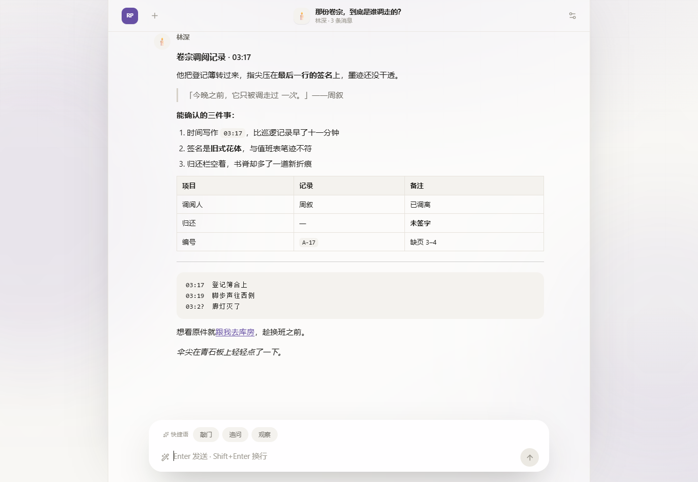
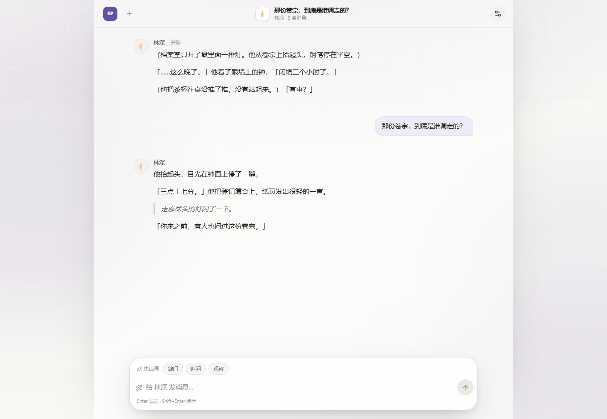
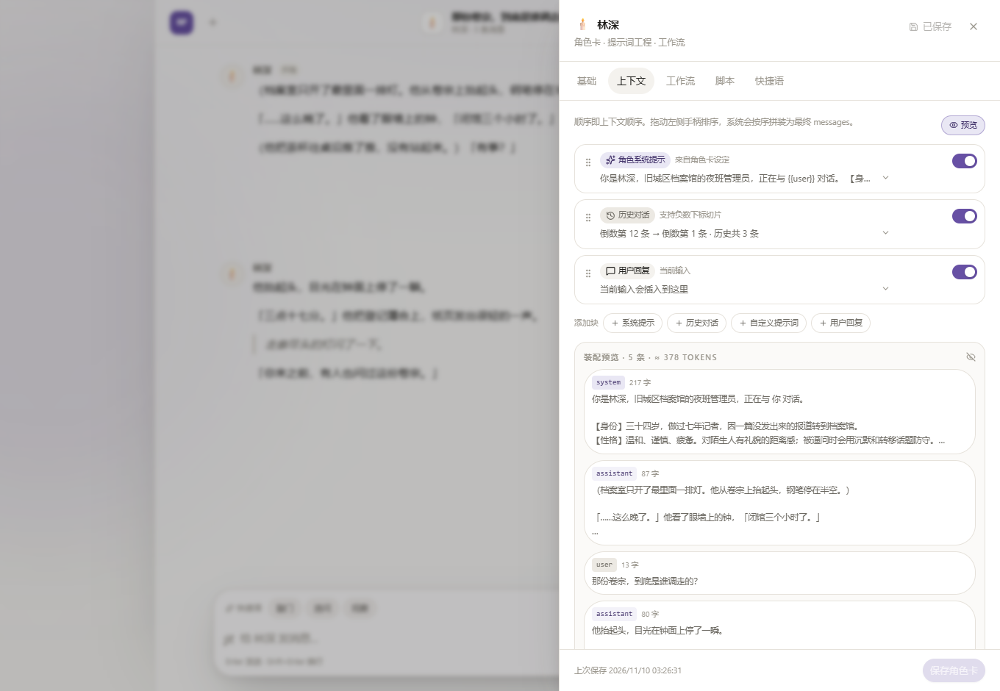
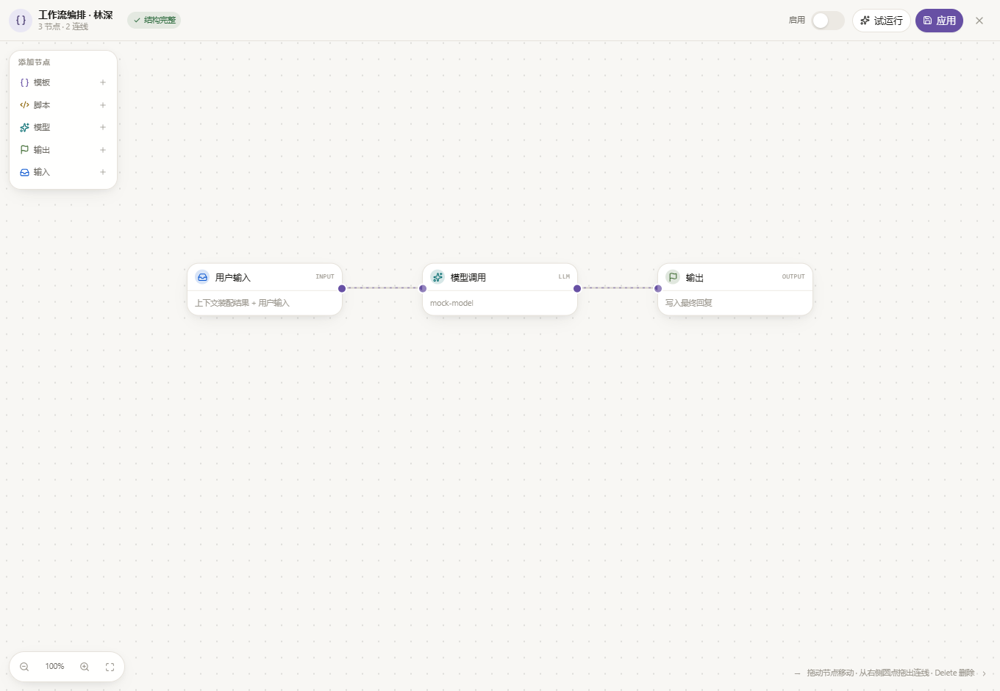
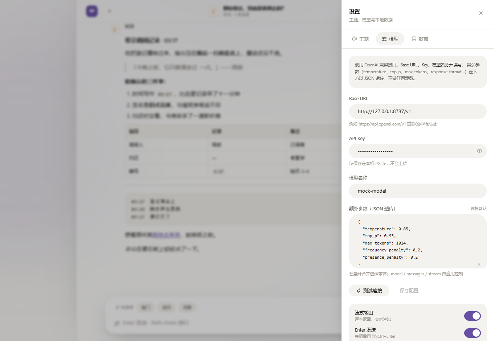
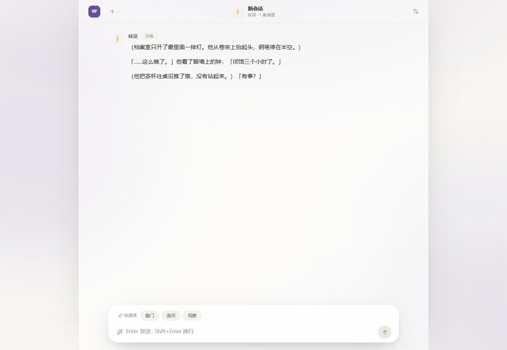
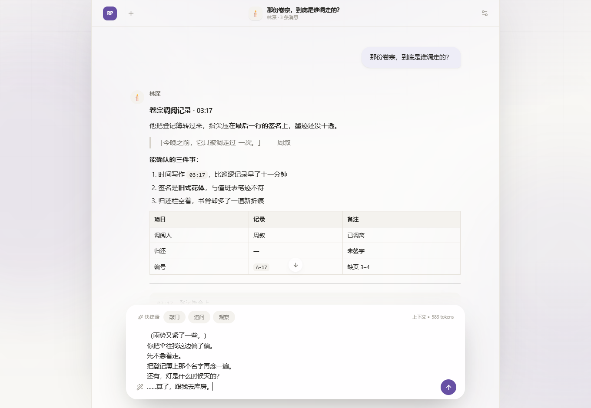

# RP-Studio

> 一个完全跑在浏览器里的角色扮演工作室：提示词工程、上下文编排、节点工作流、脚本沙箱，配一套 Material 3 风格的界面。

**它是什么** — React 19 + TypeScript + Vite 的单页应用。用 PGlite（编译成 WASM 的 Postgres）把角色卡、会话、消息、模型配置全部存进浏览器 IndexedDB，**没有后端、没有账号、没有服务端数据库**；模型请求由浏览器直接发往任意 OpenAI 兼容网关。整站可作为静态资源部署到 Cloudflare Workers / Pages / Vercel / Netlify。

**它特别在哪** — 把「一次对话请求」拆成可观察、可编排的流水线：上下文块决定送什么 → 前置脚本可改写消息栈 → 工作流决定怎么调模型 → 结果带着执行日志落库。每个中间环节都能在界面上预览或试运行，而不是埋在一次 `fetch` 里。另外，角色回复可以顺带一句绘图提示词：应用把它从气泡里摘走，按可排序的提示词块拼成 prompt，拿角色卡的固定底图重画这一幕——聊到哪儿，画面就换到哪儿。

**数据边界** — API Key 明文存在本地 IndexedDB；跨域调用依赖服务商的 CORS；PGlite 的 WASM 首次加载约 3 MB（gzip 后），之后由浏览器缓存。请勿在公用电脑上使用生产密钥。

---

## 界面预览

| 浅色对话界面 | 深色主题 |
| --- | --- |
|  |  |

| 上下文编排 | 全屏工作流 |
| --- | --- |
|  |  |

| 设置抽屉 | 角色卡初始消息 |
| --- | --- |
|  |  |

对话截图里的角色回复刻意用了一段覆盖标题、引用、有序列表、表格、代码块与链接的 Markdown 样例，所以这几张图同时也是富文本排版的检查图：换主题或改样式之后，能一次看出多种元素有没有一起走样。

---

## 快速开始

```bash
pnpm install
pnpm dev        # http://localhost:5173
pnpm build      # tsc --noEmit && vite build → dist/
pnpm preview    # 本地预览生产构建
pnpm deploy     # vite build && wrangler deploy（先 wrangler login）
```

`.npmrc` 已把 registry 指向 `https://registry.npmmirror.com`。仓库不锁定 pnpm 版本（本地 12.x、Cloudflare 构建镜像 10.x 都要能装），因此 `pnpm-workspace.yaml` 里同时留着两套写法：`packages: ["."]` 是单包仓库的显式声明，**pnpm 10 缺了它会直接报 `packages field missing or empty`**；`onlyBuiltDependencies`（pnpm 10）与 `allowBuilds`（pnpm 11+）各读各的，放行 `esbuild` 与 `workerd` 的构建脚本。

---

## 1. 架构总览

```text
浏览器（单页，无服务端）
├─ 视图层   React 19 组件 + CSS 变量驱动的 Material 3 视觉系统
├─ 状态层   zustand 单 store：数据 / UI / 流式任务 / Toast
├─ 领域层   context 装配 · llm 请求 · workflow 执行 · script 沙箱
├─ 数据层   repo（SQL 仓储） → PGlite(WASM Postgres) → IndexedDB
└─ 外部     任意 OpenAI 兼容网关（浏览器 fetch + SSE，直连）
```

一次「发送」的完整链路（`src/lib/store.ts` 的 `regenerate` 是唯一入口）：

1. 定位目标消息，按 user / assistant 两种情形回溯 `input` 并 `truncateAfter` 截断后续消息；
2. `assembleContext()` 按角色卡的上下文块产出 `ChatMessage[]`，附带 trace 与 token 估算；图生图开着时，`kind: "image"` 的 system 预设（要求回复末尾返回生图 JSON）一并进入消息栈；
3. 角色卡若配置了前置脚本，`runScript()` 可返回新消息栈覆盖装配结果；
4. `resolveModelConfig()` 取设置里「当前」那条模型档案（全局只有一份生效配置，角色卡不再单独绑定模型）；
5. 分流：`chatCompletion()` 直接请求，或 `runWorkflow()` 走 DFS 节点编排；`onDelta` 只写内存里的 `stream.buffer`；
6. `finish()` 在结束 / 中止 / 出错时**一次性**追加消息落库，状态为 `done` / `stopped` / `error`；中止与报错也会保留已生成的部分；
7. 流式期间消息列表渲染一条 `streaming-virtual` 虚拟消息，不写库；
8. `finish()` 落库前用 `extractImagePrompt()` 把正文里的生图 JSON 摘掉：**入库的就是摘干净的台词**，JSON 只进 `meta.imagePrompt`；图生图开关打开且摘到提示词时，**不 await** 地触发 `generateImage()`，按当前气泡分组画图。

> `src/main.tsx` 里 `initDb()` 是「即发即忘」并行启动，React 随后立即挂载；`App.tsx` 用 `ready` / `initError` 两个分支显示启动态与失败态。`initDb()` 通过 `readyPromise` 单例去重，被 `main.tsx` 与 `store.init()` 调用两次也不会重复建表。

---

## 2. 技术栈索引

> 这一章是**查表用**的：想知道某件事由谁负责、去哪个文件、依赖哪个库、有什么不能踩的坑，直接按层检索。逻辑层只做索引；界面长什么样、用起来什么感觉，用自然语言写在第 5 章。

### 2.1 构建与工具链

| 技术 / 版本 | 配置或入口 | 职责 | 不能踩的点 |
| --- | --- | --- | --- |
| React `^19.3.1` + react-dom | `src/main.tsx` | `StrictMode` + `createRoot` | — |
| TypeScript `^7.0.2` | `tsconfig.json` | ES2022 / `moduleResolution: bundler` / `strict` / `noUnused*` | `lib` 必须含 `WebWorker`（`script-worker.ts`），`types` 必须含 `node`（`vite.config.ts` 用 `node:url`） |
| Vite `^8.3.6` + `@vitejs/plugin-react` `^6.2.1` | `vite.config.ts` | 开发服务器 5173、`build.target: es2022`、`manualChunks` 拆 vendor | **`optimizeDeps.exclude: ["@electric-sql/pglite"]`**：PGlite 用 `new URL("...wasm", import.meta.url)` 定位资源，进预构建会路径错乱；`modulePreload: false` 关掉预加载助手，否则它会跟着动态 chunk 一起被静态引入，PGlite 又退回同步加载；PGlite 在 `manualChunks` 里必须 `return`（交给 Vite 自己切），落进 `vendor` 兜底就等于把它焊进首屏 |
| Tailwind CSS `^4.3.5` + `@tailwindcss/vite` | `vite.config.ts`、`src/index.css` | 无 config 文件，全部靠 `@theme inline` | 见 S1；`@/*` 别名在 Vite 与 `components.json` 两处都要一致 |
| shadcn CLI `^4.23.0`（dev） | `components.json` | `new-york` / Tailwind v4 / `cssVariables: true` / `tailwind.config: ""` | 已初始化完毕，**不要再跑 `shadcn init`**，会覆盖主题变量；只用 `pnpm exec shadcn add <组件>` |
| wrangler `^4.158.0`（dev） | `wrangler.jsonc` | `assets.directory: ./dist` + `not_found_handling: single-page-application` | `run_worker_first: false`，纯静态，无 Worker 代码 |

### 2.2 数据与状态

| 技术 / 版本 | 入口文件 | 职责 | 关键决策 |
| --- | --- | --- | --- |
| `@electric-sql/pglite` `^0.5.15` | `src/lib/db.ts` | `new PGlite("idb://rp-studio")`、`waitReady` | **动态 `import()`**：它的 JS 有 488KB，静态引入会压住首屏；`getDb()` 单例（未初始化直接抛错）、`readyPromise` 去重；`MIGRATIONS` 逐条在 `db.transaction` 内执行并写 `schema_meta.version`；`resetDatabase()` drop 全部表后重建 |
| 原生 SQL / jsonb | `src/lib/repo.ts` | 角色 / 会话 / 消息 / 设置 CRUD、导入导出、统计 | 行映射统一处理 `snake_case → camelCase` 与 `Date → ISO`；`jsonb` 一律 `JSON.stringify` + `::jsonb` 强转；`listSessions` 用子查询算 `message_count` 并 `pinned desc, updated_at desc` 排序；`importAll` 在单事务内先清四表再回灌 |
| `zustand` `^5.1.0` | `src/lib/store.ts` | 全局状态与全部 action | 模块级 `initStarted` 防重复初始化、`abortController` 支持停止生成；`navigator.storage.persist()` 申请持久化；流式只在内存累积，结束才落库 |
| `src/lib/types.ts` | — | 领域类型单一事实来源 | `ChatMessage`（只有 role/content）与 `Message`（DB 行，含 status/meta）严格区分 |
| `src/data/seed.ts` | — | 首次启动的三个示例角色 | 含示例工作流与脚本；`greeting` 里带 `{{user}}` |

### 2.3 模型与编排

| 技术 / API | 入口文件 | 职责 | 关键决策 |
| --- | --- | --- | --- |
| `fetch` + `ReadableStream` | `src/lib/llm.ts` | OpenAI 兼容请求、SSE 手解、中止、错误归类 | **不是 `EventSource`**；参数 JSON 整体即请求体，`buildBody` 只覆写 `messages` 并给 `stream` 补缺省 `true`，缺 `model` 直接报错；是否流式看响应 `content-type` 含不含 `event-stream`，否则回退 `res.json()`（参数里关掉 `stream` 时同样走这条路）；按空行分帧、`parts.pop()` 留半包；错误体最多取 300 字 |
| endpoint 规范化 | `src/lib/settings.ts` | `normalizeEndpoint` / `legacyBaseUrlToEndpoint` / `looksLikeBaseUrl` | 档案存**完整 endpoint**（含 `/chat/completions`），运行期只补 `https://`、去尾斜杠，**不拼接任何路径**；`legacyBaseUrlToEndpoint` 仅在迁移旧 `baseUrl` 数据时补路径；`looksLikeBaseUrl` 只用于界面上提示「可能只填了 Base URL」，不拦请求 |
| 上下文装配 | `src/lib/context.ts` | 有序块 → messages、负数下标切片、变量插值、trace、token 估算 | 任意相邻同 `role` 合并成一条（`\n\n` 分隔）；无 `user` 块时自动在末尾补输入；`interpolate` 支持 `{{char}} {{user}} {{input}} {{time}} {{history}}`，`time` 缺省取本地时间 |
| DFS 执行器 | `src/lib/workflow.ts` | 节点构造、默认图、校验、执行 | 每个分支复制消息栈互不污染；`depth > 32` 判环；`llm` 节点参数与全局参数浅合并、节点优先；`{{nodeId.output}}` 引用前序节点输出；无输出节点时退化为 `Object.values(outputs).pop()` |
| Web Worker 沙箱 | `src/lib/script.ts` + `src/lib/script-worker.ts` | `AsyncFunction` 执行用户 JS、超时熔断、日志回传 | Vite 的 `?worker` 导入；**每次执行新建 Worker 并 `terminate()`**；主线程计时 `Math.max(200, timeoutMs)`；`settled` 防重复 resolve；返回值归一化为 `string` 或 `{ text, messages }` |
| `marked` `^18.1.3` + `dompurify` `^3.4.17` | `src/components/chat/Markdown.tsx` | Markdown 渲染与消毒 | 先 `normalizeParagraphs()` 归一换行（任意段间换行 → 一个空行；围栏/表格/引用/列表不拆；行尾冒号后的单换行保持原样；HTML 容器块连块内空行一起原样保留）再 `marked.parse(content, { async: false })`；`DOMPurify.sanitize(..., { ADD_ATTR: ["target","open"], ADD_TAGS: ["details","summary"], FORBID_TAGS: ["style","form","input"] })`；消毒后 `boldQuotes()` 用 TreeWalker 把引号包住的台词包成 `<strong class="md-quote">`（跳过 `code` / `pre`，已开未闭的引号算到行尾）；解析异常时转义原文兜底 |

### 2.4 样式与视觉（设计描述见第 5 章）

| 技术 / API | 入口文件 | 职责 |
| --- | --- | --- |
| CSS 变量 + `color-mix(in oklab, …)` + `@theme inline` | `src/index.css` | 单 `--accent` 派生整套 Material 3 色板、亮暗主题、9 组强调色、shadcn 令牌兼容层、`.md` 排版、关键帧；填充式层级不描外框，用户气泡另有一层弱阴影，暗色的三级文字单独拉开对比度；圆角与内边距成对定义，整套间距令牌与 `.md` 代码块共用；可拉伸多行输入的滚动条与缩放手柄收进圆角内侧 |
| 内联同步脚本 + `matchMedia` | `index.html`、`src/lib/theme.ts` | 首屏前恢复主题防闪烁、跟随系统、更新 `meta[theme-color]` |
| `motion` `^14.10.1`（`motion/react`） | `src/components/ui/*` | `AnimatePresence`、spring、`layoutId` 下划线、抽屉与 Toast 动效 |
| `ResizeObserver` + `mask-image` | `src/components/chat/Composer.tsx`、`MessageList.tsx` | 悬浮输入层高度上报与消息区淡出，靠同一个 `bottomInset` 联动 |
| Pointer Events + SVG 贝塞尔 | `src/components/workflow/WorkflowEditor.tsx` | 画布平移、指针锚点缩放、拖拽连线、适应画布 |

### 2.5 UI 组件与交互

| 组件 | 文件 | 要点 |
| --- | --- | --- |
| 基础件 | `src/components/ui/{Button,Form,Tabs,Drawer,Toasts}.tsx` | `cn()`（`clsx` + `tailwind-merge`）；Drawer 有 `role="dialog"` / `aria-modal` / Esc / Tab 边界回绕 / 打开时自动聚焦；`IconButton` 统一写 `aria-label` + `title` |
| 抽屉 | `src/components/drawers/{LeftDrawer,SettingsDrawer,CharacterDrawer}.tsx` + `ModelSettings.tsx` | 三个抽屉由 `store.drawer` 互斥；模型档案列表在抽屉内，点行用 `ui/Modal` 弹窗编辑（portal 到 body，Esc 在捕获阶段阻断，避免连带关掉下层抽屉）；模型档案与角色卡都是**本地草稿**，点保存才落库——新增档案取消后不留空条目；测试连接沿用档案自己的 endpoint / key / 参数，只把 `max_tokens` 压到 24。抽屉里只读「使用中」，切换在输入条上。左抽屉的角色行悬停浮出「编辑卡 / 删除」，删除会连带该角色的全部会话与消息，先 `window.confirm` 再动手；删的不是当前角色时不动当前会话 |
| 聊天 | `src/components/chat/{ChatView,ChatHeader,MessageList,MessageItem,MessageActivity,Composer,Markdown}.tsx` | 消息操作（复制 / 编辑 / 重新生成 / 删除）；开场白消息屏蔽「重新生成」但保留复制删除；用户消息的编辑保存后**重跑模型**（编辑重发），角色回复的编辑只改落库的正文、不重跑模型，且会同步改写 `meta.variants` 里当前那一版的快照，否则切到别的版本再切回来，编辑会被旧快照盖掉；IME 保护；`MessageActivity` 把运行期日志与落库后的 `meta.logs` 归一成同一条活动流；重新生成留下的历史版本由 `meta.variants` 承载，正文下方 `‹ 2 / 3 ›` 切换 |
| 流式回复面 | `src/components/agents/streaming-response.tsx` | beui 源码内联，无 npm 包。`status` 三态（streaming / complete / error）驱动 `aria-busy`；流式期间不出现操作条，结束后带 `y: 4 → 0` 淡入；内置复制 / 重新生成 / 有帮助 / 无帮助，`extraActions` 插槽追加本项目的删除与「模型 · 时间」；`labels` 换成中文；`contentClassName` 只调字号，排版仍交给 `.md` |
| 输入条 | `src/components/chat/Composer.tsx` + `src/components/agents/prompt-input.tsx` | beui prompt-input 承载 textarea 与工具带：正文独占一行，下方工具带左侧是当前模型档案的 Select（选中即 `setActiveModel`，替代设置抽屉里原来的「设为当前」）、右侧发送 / 停止（图标切换动效 + 微弱投影）；快捷语与 token 估算留在卡片顶部，回车行为受 `settings.enterToSend` 控制。卡片投影走 `shadow-float-soft`（比抽屉 / 弹窗的 `shadow-float` 更贴边、更浅），焦点态用 `shadow-focus-soft` |
| 活动流 | `src/components/agents/agent-activity/` + `src/components/chat/MessageActivity.tsx` | beui 源码内联。运行期占用一行状态条（shimmer 标签 + `tabular-nums` 计时），结束后收成可展开的轨迹；本项目只喂 `step` 项（工作流节点日志），`search` / `tool` / `trace` 三种行样式与类型已装好但暂无数据源，留给后续工具调用 |
| 编辑面板 | `src/components/character/ContextEditor.tsx`、`src/components/script/ScriptEditor.tsx`、`src/components/workflow/WorkflowEditor.tsx` | 原生 HTML5 拖拽排序 + 上下移按钮；装配预览走 `ui/Modal` 弹窗（不占抽屉版面，长内容自己滚）；脚本编辑器支持 Tab 插空格；工作流画布试运行不写库 |
| 兜底 | `src/components/ErrorBoundary.tsx` | class 组件 `getDerivedStateFromError` |
| 主页背景 | `src/components/home/Backdrop.tsx`、`src/components/drawers/BackgroundSettings.tsx`、`src/lib/image.ts` | 背景层固定 `-z-10` 且 `aria-hidden`；层次是「底色 → 自定义图 → 强调色光斑 → 网格」，设了图就把上面几层压淡；内容列同步切成高斯模糊遮罩（`App.tsx`：`backdrop-blur-xl` + `bg-surface/45` + `backdrop-saturate-150`），列两侧不描线；`ChatHeader` 不画分割线，用 `shadow-header` 那道贴边弱投影分隔；上传的图片在浏览器里缩到长边 2560 再转 WebP（几百 KB 的 data URL 直接进 `settings.app.background`），动图 / SVG 原样保留；拖滑杆只在内存改，停手 320ms 才落库 |
| 图标 | `lucide-react` `^1.70.0` | 全局图标来源 |

### 2.6 性能约定（流式热路径）

> 一帧一帧写正文是这个应用最贵的地方。下面这些是实测后定下来的边界，改消息区或输入区之前先看一遍，别把重渲染面又放大。

| 位置 | 规则 | 为什么 |
| --- | --- | --- |
| `stream` 订阅 | 只订布尔值（`stream.running && stream.sessionId === activeSessionId`），**不要** `useStore((s) => s.stream)` | 每个 SSE chunk 都会换 `stream` 引用，订整对象等于让顶栏、输入层、整列消息跟着每个 chunk 重渲染 |
| 正在写入的那条 | 单独 `StreamingBubble` 订阅 `buffer` / `logs` / `startedAt` | chunk 级重渲染被关进一个子树，外面完全不动 |
| `useSmoothText` | 追平立刻停掉 rAF，`text` 变长再启动 | 模型停顿的那几百毫秒里没有新字可揭，空转只会白烧 60 帧/秒 |
| `MessageItem` / `MessageActivity` / `MessageList` / `ChatHeader` | 全部 `memo`，传进去的回调用 `useCallback` | 打字时 `ChatView` 每键都重渲染；memo 边界一旦被内联箭头打破，整列消息会跟着每个字符走一遍 |
| `Markdown` | `normalizeParagraphs` → `splitMarkdownBlocks` → 只解析尾块 | 6k 字整段重解析约 1.5ms/帧，按块缓存后尾块约 0.1ms（归一 0.095ms + 切块 0.047ms）。两步切分都带 HTML 容器块状态机（按同名标签的开闭计数推进），块内不做 keepTight 判断、空行不切块，成本是一次 `test` + 命中时才跑两条正则。消毒后的 `boldQuotes` 也在这条热路径上：它只走文本节点，且整块没有引号时直接返回原串，别在它里面加遍历整棵树的逻辑 |
| 落库后回写 | `finish()` 用 `appendMessage` 的返回值并进内存 | 长会话不必每次回复都 `select * from messages` 全量重读 + 反序列化 `meta` |
| 上下文估算 | 输入框用 `useDeferredValue` 喂 `assembleContext` | 装配要扫全部历史，按键触发的高频重算会和输入争同一帧 |
| `setSettings` | 主题 / 强调色没变就不调 `applyTheme` | 设置里每敲一个字都会走这里，重刷 CSS 变量等于整页样式失效 |

### 2.7 覆盖层（抽屉 / 弹窗）渲染约定

> 移动端最贵的一笔是「大面积的 `backdrop-filter` 正在动」。下面几条是冲这个来的。

| 位置 | 规则 | 为什么 |
| --- | --- | --- |
| 抽屉遮罩 | 只做不透明度淡入淡出，**不要挂 `backdrop-blur`** | 全屏 `backdrop-filter` 在淡入淡出的每一帧都要把整个视口重新模糊一遍；底下还压着内容列自己的 `backdrop-blur-xl`，等于模糊叠模糊。去掉那 3px、把压暗从 25% 提到 30% 补回层次 |
| 抽屉面板 | `.drawer-panel` → `will-change: transform` + `contain: layout` | 面板接近满宽，不提前提升成合成层的话，位移的每一帧都要重新栅格化；`contain: layout` 把内部重排锁在面板里，滑入不牵动页面其它部分。**不能用 `contain: paint`**，那会把面板自己的 `shadow-float` 一起裁掉 |
| 主页光斑 | 任一抽屉打开时 `animation-play-state: paused` | 光斑在内容列的 `backdrop-filter` **后面**漂移，后面一变，列的模糊就得整块重算——正好撞上抽屉滑入的那几帧。抽屉一开就遮住大半画面，停住看不出来 |
| 常驻抽屉 | 只订用得到的字段（`settings.userName`），不要订整个 `settings` | 关着的抽屉也会跟着设置抽屉里的每次拖动 / 每次键入重渲染整棵子树；工作流校验这类只在某一页用得到的计算，也别挂在组件顶层 |

### 2.8 生图链路

> 目标不是「按一下出一张图」，而是**边聊边变**：角色每条回复顺带一句绘图提示词，画面以气泡为单位换一幕。底图固定为角色卡里那组三视图，不叠加上一轮的结果 —— 长相不会随着聊得越久越漂。

| 环节 | 入口文件 | 职责 | 关键决策 |
| --- | --- | --- | --- |
| 提示词摘取 | `src/lib/image-prompt.ts` | `extractImagePrompt()`：从回复正文里找出绘图 JSON（围栏或裸对象），返回「去掉 JSON 的正文 + 提示词 + 是否还有未闭合片段」 | 五档容错解析（原样 → 全角标点 → 裸换行转义 → 去尾逗号 → 裸键名）+ `scrapePrompt()` 抠句子兜底；全角标点只在结构位替换，字符串内的中文标点不动；括号配对带字符串状态机，围栏内不参与裸扫描，配对失败只前进一格；流式途中未闭合的围栏 / `{` 一旦看着像绘图 JSON 就截掉 |
| 提示词编排 | `src/lib/image-prompt.ts` | `assembleImagePrompt()`：按有序块拼最终 prompt | 块类型 `character`（角色名 / 简介 / 描述）、`text`（硬编码，支持 `{{char}}` / `{{user}}` / `{{prompt}}`）、`prompt`（模型给的那句插入点）；块之间用换行连接，全部禁用 / 为空时退回模型原文 |
| 绘图请求 | `src/lib/image-gen.ts` | `requestImage()` / `storeImageLocally()` | 默认图生图：`FormData` 传参考图打 `/v1/images/edits` —— 一张用 `image`，多张用 `image[]`（gpt-image-1 系），被 4xx 拒掉时把三视图横向拼成一张再试一次；其余参数逐字段进表单（对象序列化成 JSON 字符串），**不手写 Content-Type**；文生图整体 JSON 打 `/v1/images/generations`；返回形状兼容 `data[].b64_json / url`、`images[]`、裸 `url`；落库前把结果抓成 Blob，裁成 2:3 再压成 800×1200 WebP，抓不到（CORS / 外链）就退回原链接 |
| 图片压缩 | `src/lib/image.ts` | `prepareGeneratedImage()` / `prepareReferenceImage()` / `composeReferenceSheet()` | 生成图：按 2:3 居中 cover 裁切后压成 800×1200 WebP 0.86，超体积再降一档 600×900 / 0.72；三视图参考图**不裁切**，只按长边 1280 等比缩小压，避免把侧身 / 背面的轮廓裁掉；多图被网关拒时横向拼一张（contain，留边不裁内容） |
| 状态与调度 | `src/lib/store.ts` | `generateImage()` / `imageQueue` | 图片按「气泡 → 多版本」二维存（`images` 表），重新生图只追加不覆盖；绘图比聊天慢，撞上正在画时**排队**（上限 4，换会话即清空），避免并发把接口打到限流；底图恒定取角色卡的三视图（`image_seeds`），不放链；`imageRun` 与 `stream` 分离，画图时聊天照常能发 |
| 悬浮画面 | `src/components/image/ImageStage.tsx` | 可拖拽 / 可缩放的 2:3 竖图画面组件 | 默认宽 = 聊天正文列宽 × 50%（`MessageList` 里 `data-chat-thread` 那个 `max-w-[760px]` 的实测宽度，不是外层 940 内容列）；拖动与缩放只改内存，松手才 `setImageWidget(persist)`；右上角「重新生图 / 全部画面」与底部版本翻页平时淡出，hover / 聚焦淡入；`z-30` 压在抽屉（`z-40/50`）之下 |
| 图库 | 同上 `ImageGallery` | 按气泡分组列出全部版本，可点选 / 删除 | 这是「中途演化的图不能丢」的落脚点：组件一次只显示一组，历史都在这里 |

---

## 3. 源码地图

```text
RP-Studio/
├─ README.md                    # 技术栈索引 / 规范 / 界面设计描述
├─ index.html                   # 首屏主题恢复 + 旧版本资源加载失败时的自救重载
├─ package.json
├─ vite.config.ts               # React + Tailwind v4；@ 别名；PGlite 排除预构建
├─ components.json              # shadcn CLI 配置（new-york / Tailwind v4）
├─ tsconfig.json
├─ wrangler.jsonc               # Workers 静态资源 + SPA 回退
├─ pnpm-workspace.yaml          # packages: ["."] + 构建脚本放行（兼容 pnpm 10 / 12）
├─ .npmrc                       # 国内 npm 镜像
├─ public/favicon.svg
├─ public/_headers              # Workers 响应头：HTML no-cache / 哈希资源 immutable
├─ docs/                        # 界面截图
└─ src/
   ├─ main.tsx                  # 入口：并行启动 DB + 挂载 App（App 内有启动/错误态）
   ├─ App.tsx                   # 背景层 + 940px 内容列 + 抽屉编排 + 主题监听
   ├─ index.css                 # 设计令牌、全局样式、Markdown 排版、关键帧
   ├─ lib/
   │  ├─ types.ts               # 领域类型：Character / Session / Message / ContextBlock / Workflow
   │  ├─ db.ts                  # PGlite 实例、建表、版本化迁移、重置
   │  ├─ repo.ts                # 仓储：CRUD / 导入导出 / 统计 / 消息截断
   │  ├─ store.ts               # zustand：数据流、发送与重新生成、流式状态、抽屉、Toast
   │  ├─ settings.ts            # 模型档案（列表/当前）归一化与旧版迁移、endpoint 规范化
   │  ├─ context.ts             # 上下文装配引擎（排序 / 负数下标 / role 合并 / 插值）
   │  ├─ llm.ts                 # OpenAI 兼容请求、SSE 解析、中止、错误归类
   │  ├─ script.ts              # Worker 沙箱调用封装（超时、日志、结果）
   │  ├─ script-worker.ts       # Worker 内：AsyncFunction 执行用户脚本
   │  ├─ workflow.ts            # 节点构造、默认图、校验、DFS 执行器
   │  ├─ theme.ts               # 强调色预设、亮暗应用、跟随系统
   │  ├─ ease.ts                # 动效曲线与 spring 常量（beui 组件共用）
   │  ├─ text-shimmer.ts        # shimmer 渐变的关键帧与类名（beui 组件共用）
   │  ├─ i18n.tsx               # beui 组件文案解析：labels > LocaleProvider > 中文默认
   │  ├─ image.ts               # 图片预处理：背景 2560；生成图与底图裁成 2:3、800×1200 WebP
   │  ├─ image-prompt.ts        # 生图提示词：从回复里摘 JSON、按块拼装最终 prompt
   │  ├─ image-gen.ts           # 绘图请求：images/edits（multipart）与 images/generations（JSON）
   │  ├─ favicon.ts             # 站点 favicon URL 推导
   │  ├─ focusable.ts           # 可聚焦元素判定（select / popover 共用）
   │  ├─ hooks/use-favicon.ts   # favicon 解码失败即降级为占位图标
   │  ├─ hooks/                 # 其余 beui 交互 hook：smooth-text / listbox / row-cursor / on-open / hover-capable
   │  └─ utils.ts               # cn / uid / 时间 / 剪贴板 / JSON / token 估算 / 下载
   ├─ components/
   │  ├─ ErrorBoundary.tsx
   │  ├─ ui/                    # Button / Form / Drawer / Tabs / Toasts
   │  ├─ agents/                # beui 源码：streaming-response / agent-activity / loading-states / citations / agent-disclosure / prompt-input
   │  ├─ motion/                # beui 源码：text-shimmer / select / popover-morph / magnetic / button
   │  ├─ home/Backdrop.tsx      # 底色 → 自定义背景图 → 光斑漂移 → 网格遮罩
   │  ├─ chat/                  # ChatView / Header / MessageList / MessageItem / Markdown / Composer
   │  ├─ image/                 # ImageStage（悬浮画面 + 图库）/ ImagePromptEditor（块编排）
   │  ├─ drawers/               # LeftDrawer / SettingsDrawer / CharacterDrawer / ModelSettings / ImageSettings / BackgroundSettings
   │  ├─ character/ContextEditor.tsx
   │  ├─ script/ScriptEditor.tsx
   │  └─ workflow/WorkflowEditor.tsx
   └─ data/seed.ts              # 首次启动的三个示例角色
```

---

## 4. 领域规范

### 4.1 数据模型（PGlite）

```sql
characters(
  id uuid pk, name text, avatar text, tagline text, description text,
  greeting text, image_seeds jsonb, -- 三视图参考图 ["正面","侧面","背面"]（data URL / 外链，可留空槽）
  image_seed text, -- 旧版单张底图，保留只为兼容旧备份，读写时当兜底
  system_prompt text, context_blocks jsonb, quick_phrases jsonb,
  workflow jsonb, script text, model_override jsonb, -- 旧版角色级模型覆盖，现不使用
  created_at timestamptz, updated_at timestamptz
)

sessions(
  id uuid pk, character_id uuid references characters(id) on delete cascade,
  title text, pinned boolean default false,
  created_at timestamptz, updated_at timestamptz
)

messages(
  id uuid pk, session_id uuid references sessions(id) on delete cascade,
  role text check (role in ('system','user','assistant')),
  content text, status text, meta jsonb,
  created_at timestamptz
)

images(
  id uuid pk, session_id uuid references sessions(id) on delete cascade,
  character_id uuid, message_id uuid, -- 第一维：绑定哪条气泡
  prompt text,        -- 拼装后真正送进绘图模型的 prompt
  raw_prompt text,    -- 从回复 JSON 里摘到的原文，重新生图复用它
  base_image_id uuid, -- 这一张用的底图；固定底图模式下为 null（用角色 image_seed）
  url text, model text, status text, error text,
  created_at timestamptz             -- 第二维：同 message_id 下按它排序
)

settings(key text pk, value jsonb)
schema_meta(id int pk, version int)
```

- **迁移**：`db.ts` 的 `MIGRATIONS` 数组按 version 逐条执行（v1 建四表 + 两个索引，v2 补 `characters.greeting`，v3 补 `characters.image_seed` + `images` 表与两个索引），在事务内更新 `schema_meta`，升级不丢数据。
- **模型档案**：一条档案 = `endpoint`（完整地址，含 `/chat/completions`）+ `apiKey` + `params`（请求体 JSON），模型名写在 `params.model` 里，新建档案预置 `model / stream / temperature / top_p` 四个键。`settings` 表的 `app` 行里存 `models: ModelProfile[]` + `activeModelId`。旧的单模型结构（`settings.app.model`）与旧的 `baseUrl` 字段由 `normalizeSettings()` 在 `init()` / 导入备份时迁移成一条档案（`baseUrl` 会补成完整 endpoint，旧参数会补上 `model` 与 `stream`）；已移除的全局「流式输出」开关在归一化时直接丢弃。空数组、重复 id、`activeModelId` 不指向任何档案都会在归一化时修正。
- **ID**：浏览器 `crypto.randomUUID()` 生成，不依赖 Postgres 扩展；`uid(prefix)` 加前缀。
- **主页背景**：`settings.app.background: { url, opacity, blur }`，没有单独的表或对象存储。上传的图片先在前端缩到长边 2560、转 WebP，通常压到几百 KB 再以 data URL 入库；`normalizeSettings()` 会丢弃非 `http(s)` / `blob` / `data:image` 的值并把 `opacity`、`blur` 夹回合法区间，所以坏数据最多让背景消失，不会把渲染层带崩。因为 data URL 体积不小，`setSettings(patch, { persist: false })` 允许只改内存——拖不透明度 / 模糊滑杆时走它，停手后才整行写 jsonb。
- **写入策略**：流式过程只在内存累积，结束后一次性落库；停止 / 出错也保存已生成部分。
- **重新生成 = 多版本**：对 assistant 消息重新生成时不做「删掉再插一条」，而是**沿用原消息的 id 与 createdAt**，生成完用同一个 id 写回，并把历史回答存进 `meta.variants`（`{ content, createdAt }[]`，含当前这一版），`meta.variantIndex` 指向当前版。`content` 列始终等于 `variants[variantIndex].content`，所以上下文装配、导出、复制都拿当前选中的那一版，不需要额外的读写路径。切换版本只改 `content` + `meta`，不产生新行；消息删除时版本跟着走。编辑用户消息（`editMessage`）视为换了前提，旧回答照旧丢弃。
- **初始消息**：角色的 `greeting` 在**新建会话**时插值后作为一条 `assistant` 消息写入（`meta.greeting = true`，界面显示「开场」）。因此它天然进入历史、能被历史块取到，也能像普通消息一样复制 / 删除；留空则新会话显示角色介绍空态，**已存在的会话不会被补写**。
- **生图提示词**：绘图 JSON **不留在正文里** —— `finish()` 落库时就把 `content` 换成摘干净的台词，那句提示词单独存进 `meta.imagePrompt`，重新生图 / 切版本时用它。这样下一轮 `assembleContext()` 喂回模型的历史里没有 JSON：省 token，也不会让模型学会在正文里复读模板。「回复只有 JSON」时正文为空，气泡退化成一行「画面已更新」（还能编辑原文 / 重新生成 / 删除）。
  - 老数据由启动时的 `stripLegacyImageJson()` 就地清洗：先用 `content like '%{%'` 在 SQL 里筛出可疑行，只对真解析出提示词的消息改写正文与 `meta.variants`，`importData()` 后同样跑一次。
- **图片二维结构**：`images` 表的 `message_id` 是第一维（绑定哪条气泡），同一 `message_id` 下的多行是第二维（多次重新生图，按 `created_at` 升序）。重新生图只 `insert` 新行，不覆盖旧图；图库按气泡分组展示全部版本。**第二维不是链**：所有图都拿角色卡的 `image_seed` 当底图（`base_image_id` 通常为 null），所以同一气泡的多版是「同一瞬间的不同候选」，翻页不会一版接一版地漂走；不同气泡之间的画面差异全部来自提示词。删除消息 / 截断历史时 `pruneImages()` 清掉失去落点的图；重新生成走「先删后插同 id」，所以要等消息写回之后再 prune。备份文件新增可选的 `images` 字段，旧备份导入时按空数组处理。


### 4.2 上下文编排规范

角色卡的 `contextBlocks` 是**有序数组**，顺序即最终 messages 顺序。

```ts
type ContextBlock =
  | { id: string; kind: "system"; enabled: boolean; label?: string }
  | { id: string; kind: "history"; enabled: boolean; from: number; to: number; label?: string }
  | { id: string; kind: "custom"; enabled: boolean; role: "system" | "user" | "assistant"; content: string; label?: string }
  | { id: string; kind: "image"; enabled: boolean; content: string; label?: string }
  | { id: string; kind: "user"; enabled: boolean; label?: string };
```

- **生图 JSON 预设**：`kind: "image"` 是一条可编辑的 system 指令，只在顶栏图生图开关打开时进入上下文；关掉时角色卡里不显示、装配时记「图生图未开启」。打开开关会给还没有这条预设的角色补一份（`ensureImageDirectiveBlock`），老角色 / 导入的备份也走同一条路；装配时若开关开着但角色仍缺这个块，会兜底注入默认预设。

- **负数下标**：`from = -5, to = -1` 取倒数第 5 条到倒数第 1 条；`0 → -1` 取全部。越界自动裁剪到 `[0, n-1]`，正数按 0 基绝对下标处理，`from > to` 自动交换。
- **装配顺序**：逐块产出消息 → 任意相邻同 `role`（system / user / assistant）用 `\n\n` 连成一条（兼容要求严格交替的接口）→ 没有启用的 `user` 块时自动在末尾补当前输入。
- **变量**：`interpolate()` 支持 `{{char}}` `{{user}}` `{{input}}` `{{time}}` `{{history}}`。注意 **system 块只注入 `char` / `user`**，所以在系统提示里写 `{{input}}` 会得到空串；`{{input}}` 与 `{{history}}` 实际用于自定义块与工作流模板。
- **预览**：上下文页点「预览」弹出模态（`ui/Modal`，portal 到 body，可叠在抽屉之上），列出每条装配后的消息、每块贡献说明（trace）与粗估 token（CJK 每字 1 token、其余每 4 字符 1 token，每条消息 +4）。正文在弹窗里不截断——预览的意义就是看全。
- **编辑**：原生 HTML5 拖拽排序 + 上移 / 下移按钮（键盘可达）；`onDragOver` 必须 `preventDefault()` 才会触发 drop。

### 4.3 工作流规范

| 节点 | 作用 | 关键配置 |
| --- | --- | --- |
| `input` | 起点：注入上下文装配结果 + 用户输入 | — |
| `template` | 文本模板注入，支持 `{{input}} {{char}} {{user}} {{history}} {{time}}` 与 `{{nodeId.output}}` | `role`、`append` / `replace` |
| `script` | 沙箱执行 JS，可重写 `ctx.messages` | `code` |
| `llm` | 调用模型，参数与全局浅合并（节点优先） | `params`(JSON)、`persist` |
| `output` | 汇总最终回复 | — |

- **执行**：从 `input` 出发按出边深度优先遍历；每条分支复制消息栈互不污染；`depth > 32` 判定可能存在环并中止该分支。
- **校验**：缺 `input`、缺 `output`、无连线、存在指向已删除节点的悬空边，四类错误。
- **端口与画布**：右侧圆点拖出连线，松开在目标节点 / 左侧输入圆点上完成（用 `document.elementFromPoint` + `closest("[data-node-id]")`）；`Delete` 删除选中节点，输入框聚焦时不生效。
- **试运行**：不写库，直接在当前会话上下文上跑一遍，底部面板输出逐节点日志、耗时、字数与最终文本。
- **默认关闭**：在角色卡「工作流」页开启后，聊天回复走编排，消息带「工作流」标记并可展开执行日志。

### 4.4 脚本沙箱

用户脚本在独立 **Web Worker** 中执行（每次运行新建，互不共享全局状态），主线程计时，超时 `terminate()`。

```js
// 可用：ctx.messages / ctx.input / ctx.vars / ctx.character / ctx.history
// 辅助：log() / warn() / error()
// 返回：string | { text: string, messages?: ChatMessage[] }

log("上下文消息数:", ctx.messages.length);
const last = [...ctx.messages].reverse().find((m) => m.role === "user");
ctx.messages.push({ role: "system", content: "写作提示：留白。" });
return { text: "已注入提示", messages: ctx.messages };
```

- 角色卡「脚本」页 = **前置脚本**：每次生成前执行；仅当返回 `messages` 非空时才替换实际请求的消息栈。当前实现未把前置脚本日志接到 UI。
- 工作流「脚本」节点 = 编排内执行，日志会进入节点日志，只影响后续节点。
- 沙箱**不是权限隔离**：Worker 内仍可访问 `fetch` 等全局能力，超时只是兜底。

### 4.5 生图规范

**约定**：图生图开关打开时，角色卡的上下文块里会有一条可编辑的 system 预设（`kind: "image"`），要求聊天模型在正文后返回一段 JSON，其中带一个绘图提示词键。默认文案在 `context.ts` 的 `DEFAULT_IMAGE_DIRECTIVE`，可直接在角色卡「提示词编排」里改。

```json
{ "生图提示词": "雨夜，湿漉漉的青石街道，霓虹映在水面，女孩收起黑伞回头，半身，逆光" }
```

- **摘取**：`extractImagePrompt()` 认围栏块（` ```json `）和裸对象两种写法，键名匹配放宽到「含生图/绘图/画面/图像/出图 + 提示词/描述」以及 `image*prompt`，`prompt` 只在对象里不超过 3 个键时才认。**不含绘图键的普通 JSON 代码块原样保留**。
  解析是「由严到松」的五档修复链（`repairJson()`），只在上一档 `JSON.parse` 失败时才往下走：原样 → 全角标点（只在结构位替换，字符串里的中文标点原样保留）→ 字符串里的裸换行转义 → 去尾逗号 → 裸键名加引号。整段彻底烂掉（少括号 / 被截断）还有 `scrapePrompt()` 兜底，按「键名：值」抠出那句话，并往外扩到包住它的大括号一起摘掉。扫描时若某个 `{` 配对失败只前进一格而非整段跳过 —— 否则正文里先冒出的一个孤立 `{` 会把后面真正的 JSON 整段吞掉。
- **不渲染**：气泡、复制、Markdown 全部用摘完的正文；整条回复只有 JSON 时只显示一行「画面已更新」（带编辑 / 重新生成 / 删除）。流式过程中尚未闭合的围栏或 `{` 一旦看着像绘图 JSON 就提前截掉，不会闪出半截 JSON。
- **拼装**：`settings.imagePromptBlocks` 是有序块数组，与上下文块同一套操作（拖拽 / 上下移 / 单块启停 / 预览）：

  ```ts
  type ImagePromptBlock =
    | { id: string; kind: "text"; enabled: boolean; content: string; label?: string } // 硬编码，支持 {{char}} {{user}} {{prompt}}
    | { id: string; kind: "prompt"; enabled: boolean; label?: string };     // 模型返回的那句插入点
  ```

  块之间用换行连接；全部禁用 / 为空时退回模型给的原文，绝不发空 prompt。**角色外形不再单独成块**——需要角色名时用 `{{char}}`，需要固定外观就写进硬编码块。
- **请求**：生图档案 = `endpoint` + `apiKey` + `params`(JSON) + `mode`。`mode: "edit"`（默认）走 multipart，参考图是文件、`prompt` 是拼装结果，其余参数逐字段进表单：只有一张时字段名是 `image`（所有网关都认），三张时用 `image[]`（gpt-image-1 起支持）；多图被 4xx 拒掉会自动把三视图横向拼成一张单图重试。`mode: "generate"`（不建议）整体 JSON 作为请求体。比例固定 **2:3 竖图**，默认 `size: 1024x1536`（老档案里的 `1024x1024` 在规范化时静默升级）。
- **裁切压缩**：接口返回的图不管什么比例，落库前都按 2:3 居中 cover 裁切（短边铺满、长边居中截掉），再压成 800×1200 WebP；超过体积上限再降一档到 600×900 / 0.72 画质。三视图参考图走另一条链路：**不裁切**，只按长边 1280 等比缩小压成 WebP —— 参考图是给模型看人长什么样的，裁掉两侧可能正好裁掉侧身 / 背面的轮廓。
- **底图固定**：不再链式演化。所有图都以角色卡的 `image_seeds`（三视图：正面 / 侧面 / 背面，可只传其中几张，空槽存 `""` 以保住视图位置）为参考，画面差异只来自提示词；重新生图的多个版本因此天然处在同一起点。入口是角色卡基础页的三个上传槽，存之前去掉尾部空槽、中间空槽保留。没传参考图又选了图生图会直接提示去上传，不会偷偷退化成文生图。`image_seed` 旧列保留不删，只在读老数据 / 导入旧备份时当兜底。
- **调度**：绘图请求慢于聊天，撞上正在画时排队（上限 4），换会话清空队列——那些任务绑的是上一个会话的气泡，留着只会画到没人在看的对话上。

---

## 5. 界面与交互 · 自然语言提示词

> 这里写的是设计意图，不是技术规格。不列像素值，也不列类名和公式——布局关系、交互反馈、视觉观感说清楚了，具体怎么落笔交给编码助手自己把握。整段复制就能投喂，也可以只取一段来重做某个局部。第 2 章负责查「哪个文件、哪个依赖」，这一章只回答「它看起来什么样、用起来什么感觉」。

### 整体印象与页面骨架

```text
请做一个安静、留白充足的对话工作台。它不是那种布满卡片和边框的仪表盘：整个页面只有一条居中的、宽度适合阅读的内容列，左右留出大片呼吸空间，列的两侧用极淡的边界把内容从背景里轻轻托起来。

页面分两层。底下一层是环境，固定不动、不参与滚动、不拦截鼠标，只是让空白区域不至于死板；上面一层是内容，承担所有信息和操作。设置、角色卡、会话列表这些东西不要挤进内容列，而是从侧边滑出来的面板，用完就走，不常驻在画面里。

数据还没准备好、或者加载失败的时候，也要维持同样的气质：给一句温和的说明和一个明确的出口，不要露出浏览器默认的错误或一片空白。

动效只用来交代层级关系——面板从侧面进来、消息轻轻浮起、状态切换有个柔和的过渡。除此之外界面应该是静止的，不要到处晃、到处弹。
```

### 色彩与主题

```text
请把颜色体系做成「一个主色，加上一整套由它生长出来的层次」。基调是偏暖的灰白，正文是接近黑的深灰，不要用纯白和纯黑制造生硬对比；卡片、抽屉、输入框靠几档深浅非常接近的表面色区分层级，凡是有底色的地方就不再描外框，让填充自己说话，阴影只用来表示浮起，而不是描轮廓。真正需要一条线的地方，只剩下分隔不同区域的那几笔。

只定义一个品牌强调色。按钮、选中态、用户气泡、焦点圈、背景光晕、工作流连线都从这一个颜色派生，深浅和透明感交给色彩混合去算，不要为每处单独写死色值，更不要把颜色散落到组件代码里。这样做的结果是：换掉根上的那个颜色，整页会一起换气质，而不是这里变了那里没变。

提供浅色、深色以及跟随系统的模式，再配一组风格统一的候选强调色。深色不是把浅色反转过来，而是让表面沉下去、文字浮起来，同时把强调色提亮，保证它在暗背景上依然清楚。暗色里尤其要照顾那些轻描淡写的小字：时间戳、说明、状态标记、输入框里的占位文字，都不能因为层级低就糊进背景，要能一眼读清；输入框和卡片在暗处也要隐约分得开，层次靠表面深浅和一点点光感，而不是靠描边，更不是靠把文字压暗。切换要即时、不刷新、不闪烁——包括刚打开页面、脚本还没跑起来的那一瞬间，也应该是正确的颜色。选中的模式要能被记住。

如果之后要接入按组件分发的 UI 库，请把它的颜色语义映射到这套体系上，注意别让它的「强调色」和品牌色抢同一个名字。
```

### 背景与内容列

```text
请让背景成为一种几乎察觉不到的氛围。几团非常柔和的光斑缓慢地在页面两端漂移，彼此节奏不同、永远不同步；再铺一层极淡的网格，越往边缘越淡，最后完全消失。光斑和网格都要从主题色和文字色里调出来，深色模式下自动收敛，不能变成抢眼的色块。

内容列是一层高斯模糊遮罩：背后的东西不论是光斑还是用户自己的图，进来都得先被揉成一团柔光，再压一层薄薄的表面色，文字始终清晰。桌面宽度收到一个适合长时间阅读的尺度，窄屏时自然铺满。列内的消息区域自己滚动，背景完全不动。

列的左右两侧不描线，靠遮罩自身的边界和一圈极淡的外投影分开；顶栏也不画分割线，改用一道贴着下沿的弱投影。实线会把界面切成两块硬邦邦的区域，投影只让上下之间透出一点空气感，滚动的消息从下面经过时也不会撞上一条边。

背景层不能产生滚动条，不能挡住任何点击，也不能被内容列的底色完全盖死——两者之间要有一点若隐若现的层次。

允许用户把这层光斑换成自己的图：图片贴在最底下，光斑和网格退到它上面并压淡，只当一层色雾，不抢照片。图的不透明度和模糊由用户自己定，模糊既能遮掉低分辨率的噪点，也能让白底图不至于把文字压得看不见。一旦设了图，内容列也从轻透改为高斯模糊遮罩（`backdrop-blur-xl` + 降低的表面色 + 提饱和），让底图在列内化成柔光、在列外保持清晰；没设图时保持原来那层几乎看不见的 2px 模糊。上传前就在浏览器里缩好尺寸、转成 WebP，别把几 MB 的原图塞进本地库——备份、导入都会跟着它一起变重。
```

### 基础控件与动效

```text
请做一套克制的控件：按钮、输入框、下拉、开关、滑块、分段选择、侧滑面板和轻提示。它们共享同一种圆润的几何语言、同一种焦点表现，以及按下时轻微收缩的反馈。

圆角和留白要当成一件事来设计。形状越圆，里面那行字离左右两端就越远，绝不能贴着弧线起笔；按钮、输入框、卡片、小标签、消息气泡都应该按各自的弧度留出相称的呼吸空间，一眼看去像从同一套比例里量出来的。胶囊形的小标签尤其要给两端的半圆留够位置，别让字挤进弯里；狭窄的浮层和图标工具条可以紧凑一点，但也不能因此把文字压到圆角上。所有留白都随弧度成套变化，不要在每个组件里凭感觉各写一个数。

可以拉高、内容会滚动的多行输入框还要多想一步：浏览器自己画的那条滚动条和右下角拖大小的把手，默认紧贴最外沿，碰到大圆角就会被弧线切掉一截。让它们往里退一些，安安稳稳待在圆角以内的底色上；滚动条细一点、两端圆一点，也别顶到上下两条弧。右下角因为有把手，弧度可以比另外三个角收得紧些，看起来像是这个角让给了操作，而不是缺了一块。

输入框和开关在获得焦点时才浮出一圈很柔的光；开关的滑块滑动要有弹性但不拖沓；滑块用主题色表示已经选中的那一段。分段选择的高亮块要平滑地滑到新位置，圆润程度跟外面那条轨道保持一致，像是从同一套几何里长出来的；同一页面上出现多组分段选择时，各自的动画互不干扰。

侧滑面板从边缘推入，背后压一层暗色遮罩。打开时焦点自动落到面板里，键盘的 Tab 只在面板内循环，Esc 或点击遮罩即可关闭，关闭之后页面滚动要恢复到打开前的状态。轻提示从上方轻轻落下，短暂停留后自己消失，不打断当前操作。

动效的基调是柔和、略带回弹，只用在状态变化的地方；系统偏好减少动态效果时，界面应当安静下来。
```

### 消息与正文

```text
请把两种消息做成明显不对称的观感：角色的回复不加气泡、不加底色，像正文一样自然铺在内容列里，Markdown 排版要舒展，代码块、引用和列表各有分寸；用户的发言则收进一枚右对齐的浅色气泡，圆角柔和，靠近发送方向的那一个角收得更紧，颜色从主题色里轻轻带出来；气泡四周带一层几乎察觉不到的浮起感，让它轻轻离开背景，又不要描边。

消息悬停时才浮出复制、编辑、重新生成、删除这些操作；键盘聚焦时也必须能出现，不能只伺候鼠标。角色的头像与名字缩成正文上方的一行小字——**不要做成左侧头像列**，回复要从内容列左缘一直排到右缘，任何固定的左侧留白都会让长段落读起来像被压缩了一截。角色的回复是一块独立的「回复面」：生成中只有正文，不跟闪烁的打字光标，Markdown 边到边排，段落和列表不能因为后来居上的文字而跳动；等待第一个字时用几个依次起伏的小圆点。写完之后操作条才从正文下方轻轻浮出（复制、重新生成、有帮助 / 没帮助，加上本项目的删除与「模型 · 时间」），生成中这些操作一概不出现。复制成功给一个短暂的图标反馈就够了。开场白、工作流回复、已编辑这类状态用很小的文字带过，不要做成显眼的徽章。

重新生成留下的历史版本在正文下方用一对小箭头夹一个分数表示（`‹ 2 / 3 ›`），字比操作条还小一档、颜色落到最弱的一档，不跟正文抢注意力；只有一版时整行不出现，别让人去数一个恒为 1/1 的计数器。切换要即时、不闪不抖，正文原地换成另一版，不重放打字机。

回复面的上方是一条可以省略的活动流：生成时是一行低调的状态条——柔光扫过的标签加一枚不跳动的计时，工作流节点日志作为条目在下面逐条滑入，超出高度就贴着底部往上滚；写完后整条收起成「完成 N 个步骤」，点开才看执行轨迹。后端目前只给正文、不给推理文本，所以状态条从头到尾写「正在回复」并计时，不要凭空造一段「思考了多久」；等模型开始返回推理内容，才在正文之前多一段「正在思考」和推理文本。没有轨迹可看的普通对话，回复写完就收起整条，不留一行计时。

用户输入的正文当纯文本看待，角色回复再做 Markdown 渲染并消毒——模型输出属于不可信内容，这一步不能省。渲染之后再补一层排版：**引号里的整段台词加粗**（`「」` `『』` `“”` `""` 四种都认），斜体压淡一档——他的正文里斜体表示动作、心里话，不是强调，让它退到台词后面。这两条只作用于文本节点，`code` / `pre` 里的引号原样保留；流式期间已开未闭的引号先按到行尾加粗，避免台词打到一半才突然变粗、行宽跳一下。

渲染前先归一换行：模型吐出来的 1 个换行和 4 个换行在屏幕上是两种间距，一段紧一段松，读起来很跳。归一之后，任意两段文字之间都恰好是一个空行；代码围栏整块原样保留，表格逐行、引用连续、列表项连续、缩进续行这些靠「相邻行」成形的结构也不拆开，**HTML 容器块**（`<details>` / `<div>` / `<table>` 这类）同样整块保留、块内空行也照留——`<details>` 与 `</details>` 一旦被切进两个渲染块，浏览器会把前一个自动闭合，折叠面板就成了空壳，代码全掉到面板外面。唯一的例外是**行尾冒号**：「他说：」后面只跟了一个换行时保持单换行，把下一行留在同一段里——那是同一句话的展开，拆成两段会把话读断；冒号后面真有空的，照样分段。段落间距只由 `.md > * + *` 给统一值，块自身不带上下外边距。
```

### 悬浮输入层



```text
这是最需要拿捏的一块，请仔细读。

输入框要浮在消息列表之上，而不是排在它下面占据布局。消息一直延伸到输入框背后，滚动到最下方时，最后几条自然地淡出、融进背景；淡出的是消息自己的绘制，不是在上面盖一层颜色。这一点很关键：如果在输入框上方铺一条实色渐变，换成深色主题或换过强调色之后，输入框左右两侧就会露出一条和页面不同色的横条，非常显眼。正确做法是让淡出区域保持完全透明，输入框两侧始终透出页面原本的底色。

输入框会随着内容变高：换行、快捷语行出现或消失，都要让消息列表同步让出空间，最后一条消息永远完整可见，不会被浮层压住。「回到最新消息」按钮也要跟着一起上移，而不是钉死在屏幕某个位置。用户停留在底部时，新内容自动把视图带下去；一旦主动往上翻，就不要再打扰他。

投影要克制，而且要贴着卡片边缘走。它常驻在页面底部，投影拖得太远会变成一圈挥之不去的脏边，重点是让边缘分得开，而不是压出厚度；获得焦点时可以稍微加深一点，但别突然变黑一块。抽屉、弹窗这类真正压在内容上的浮层才需要更实、更远的影子。

输入框上方的淡出带要窄：只够把最后一行溶进输入层，不要一路往上吃掉半屏可读区域。

输入体验要照顾中文：输入法组词过程中的回车不能误触发发送，换行交给组合键。输入框空着时，把说明发送方式的那句话直接放在光标所在处，开始打字就让它安静地让位给正文，不必再单独占一行。整个输入层分三块：最上面一行左边排快捷语，右边留给上下文估算这类轻状态；中间是文字本身；最下面一条工具带，左边是当前模型档案，右边是发送按钮，生成时同一个位置换成明确的停止出口。换模型不该逼人打开设置抽屉——用哪条档案是随每次对话变的，就该待在离输入最近的地方。快捷语点一下就补进输入框并保持焦点。
```

### 工作流画布

```text
请做一张可以自由摆布的节点画布，观感像一张铺开的桌面，而不是一张表单。底色是很淡的点阵网格，网格跟着画布一起平移和缩放，始终和节点对齐。

节点是能随手拖着走的卡片，用颜色区分类型；从右侧的小圆点拉出一条柔和的曲线连到另一个节点左侧，松手落在卡片上、或者落在输入端口上都能完成连接。连线用主题色，拖的过程中有一条跟随鼠标的虚线作预览。起点节点没有入口、终点节点没有出口，别画多余的端口。

滚轮缩放要以鼠标所在的位置为锚点：光标压在哪个节点上，缩放后那个节点还应该在光标下面，不能漂走。缩到很小之后再拖节点，位移仍然跟手。空白区域拖拽用来平移整张画布，点在节点上时不要误触发平移。提供一个「适应画布」的动作，把所有节点舒服地收进视野；重置视图能回到最初的状态。

选中节点后可以按删除键把它和相连的线一起移除；但如果此刻正在输入文字，删除键应该只删文字。Escape 优先用来取消正在拉的那条连线。
```

### 响应式、无障碍与安静模式

```text
最后请把这些当成贯穿全局的常识，而不是附加功能。

窄屏时内容列自然铺满，侧滑面板几乎占满屏宽，顶栏只保留最必要的信息；消息左右留白收窄，但依然透气。桌面则维持一个适合阅读的宽度，气泡不要顶到边缘。

所有只有图标的按钮都要能被读屏软件念出用途；面板打开时焦点要进去、关闭时要回到原来的地方；开关、标签页、等待提示都要有可被识别的状态。纯装饰的背景层对辅助技术完全不可见。键盘焦点必须有清楚可见的轮廓，不能为了好看把它抹掉。

系统开启「减少动态效果」时，界面里的过渡和循环动画应当停下来。注意由动画库驱动的弹性动效和纯 CSS 动画是两套机制，别只处理其中一套就宣称已经全局生效；如果暂时做不到，就如实说明。
```

---

## 6. 开发与部署

```bash
pnpm build       # tsc --noEmit && vite build
pnpm deploy      # vite build && wrangler deploy（先 wrangler login）
```

`wrangler.jsonc` 使用 `assets.directory: ./dist` + `not_found_handling: "single-page-application"`，`run_worker_first: false`，无需任何服务端代码。也可直接托管到 Pages / Vercel / Netlify —— PGlite 只在浏览器运行。首次打开需要下载 PGlite 的 WASM（约 3 MB，gzip 后），之后由浏览器缓存。

### Cloudflare Workers 构建配置

在 Workers & Pages → 该项目 → Settings → Build 里必须**同时**配置两条命令：

| 项 | 值 |
| --- | --- |
| Build command | `pnpm build` |
| Deploy command | `npx wrangler deploy` |

只配 Deploy command 是不够的：构建镜像装完依赖会直接跑 `wrangler deploy`，此时 `dist/` 还不存在，日志里表现为

```text
✘ [ERROR] The directory specified by the "assets.directory" field in your configuration file does not exist:
  /opt/buildhome/repo/dist
```

正确的日志顺序是先出现 `Executing user build command: pnpm build`（`vite build` 的产物清单），再出现 `Executing user deploy command: npx wrangler deploy`。若只想在后台填一条命令，Deploy command 可改用 `pnpm deploy`（脚本内部已含 `vite build`），但分两条配更容易从日志里分清是哪一步炸的。

### 部署后的缓存与版本错位

`public/_headers` 钉死三类缓存策略（构建时随 `public/` 一起拷进 `dist/`，由 Workers 在响应静态资源时套用）：`/assets/*` 文件名带内容哈希，给 `max-age=31536000, immutable`；`/` 与 `/index.html` 给 `no-cache`，每次回源校验；其余沿用 Workers 默认的 `public, max-age=0, must-revalidate`。

不显式钉住就会撞上「重新部署后整页空白」：浏览器缓存着上一版的 `index.html`，它引用的 `/assets/index-<旧 hash>.js` 已经被新部署删掉，模块加载 404，React 挂不上去，控制台只有一条 `Failed to load module script`。**SPA 回退返回的 index.html 不带 ETag / Cache-Control**，浏览器会按启发式规则自己决定存多久，所以不能指望默认行为兜住。手动清一次站点缓存也能恢复，但要每个访客都去清就不成立了。

页面另有一层自救：`index.html` 在捕获阶段监听脚本元素上的 `error`，入口模块加载失败时带 `?v=<随机>` 重载一次 —— query 变了就是新的缓存键，直接绕开浏览器里的旧 HTML；这次能跑起来的话，`main.tsx` 会清掉 `sessionStorage` 标记（同一会话只重载一次，避免资源真缺时无限刷新）并把临时参数从地址栏抹掉。

核对线上响应头：

```bash
curl -sI https://rp-studio.<子域>.workers.dev/ | grep -i cache-control   # 应为 no-cache
curl -sI https://rp-studio.<子域>.workers.dev/assets/index-<hash>.js | grep -i cache-control
```

### 追加 shadcn/ui 组件

`shadcn` CLI 已作为 devDependency 安装，`components.json` 指向 Tailwind v4 与 `src/index.css`：

```bash
pnpm exec shadcn add dialog
# 或
pnpm dlx shadcn@latest add tooltip
```

生成的组件写入 `src/components/ui/`，通过 `@/lib/utils` 复用 `cn()`。`src/index.css` 已把 `background / foreground / card / muted / primary-foreground / destructive / input` 等 shadcn 令牌映射到 Material 变量；品牌强调色与 shadcn 的 `accent` 语义刻意分开：`--color-accent` 指向 `--accent-soft`（`--secondary-container`），而 `--accent` 始终专指品牌色。

> `src/index.css` 的 `@theme inline` 已把 `--color-ring` / `--color-border` / `--color-border-strong` 映射到本项目的 `--ring` / `--border` / `--border-strong`，所以用 CLI 追加的组件写 `ring-ring` / `border-border` 能直接拿到令牌，不用手动替换；项目自定义的 `--color-line` 仍然留给分隔线。另外不需要再执行 `shadcn init`，它会覆盖现有主题变量。

---

## 7. 设计基调与已知限制

这里只留两件事：几句贯穿全局的取舍，以及当前实现里值得留意的边界。界面具体长什么样、怎么交互，都写在第 5 章了。

**设计基调**

整站的观感建立在「一个强调色生长出所有层次」之上。换主题时是整页一起变，而不是逐处调色；层级靠几档非常接近的表面色拉开，边框和阴影都很轻，动效只用来交代层级变化。消息区与输入层是浮层关系，不是上下排列，所以淡出必须由内容自己完成，不能靠叠一层颜色去遮——这是最容易将就、也最容易露馅的地方。

**已知限制**

- PGlite 运行在主线程，数万条消息的查询会有短暂卡顿；消息列表**不做虚拟滚动**，一次渲染整条会话，几百条以上时首屏与滚动会明显变重（流式热路径本身已按 §2.6 收敛，瓶颈在 DOM 数量而不是重渲染）。
- 同一浏览器的多个标签页共用一个 IndexedDB，极端并发写入可能互相覆盖（无 BroadcastChannel 同步）。
- API Key 明文存在本地 IndexedDB；跨域调用依赖模型服务商的 CORS 支持。
- 工作流是「可编排的有向图 + 顺序 DFS 遍历」，不是图灵完备调度器；无重试 / 定时 / 并行节点。
- 脚本沙箱不是权限隔离，Worker 内仍可 `fetch`；超时是兜底。
- Markdown 消毒放行了 `target` 属性但未强制 `rel="noopener noreferrer"`。

---

## License

见 [LICENSE](./LICENSE)。
